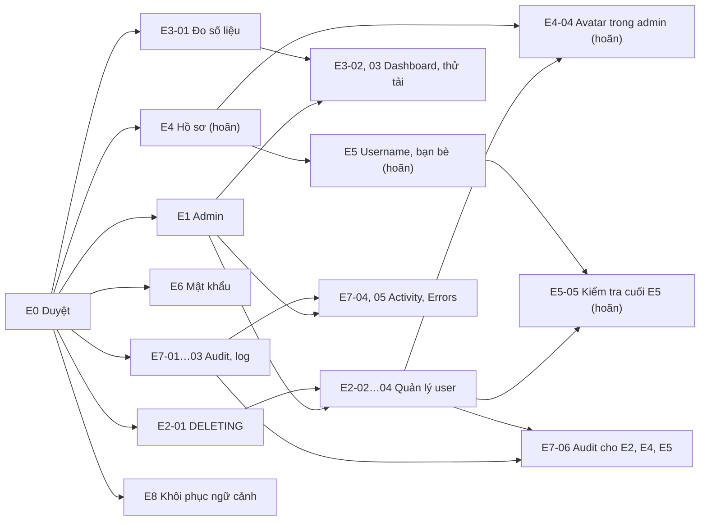

# MILESTONES — Kế hoạch, tiến độ và nghiệm thu

> Tài liệu 3/3 của Design Baseline v1.0: **CÔNG VIỆC, TIẾN ĐỘ, KIỂM CHỨNG, NGHIỆM THU**. Yêu cầu: [CONTEXT.md](CONTEXT.md). Thiết kế: [ARCHITECTURE.md](ARCHITECTURE.md).
>
> `BASELINE_VERSION: 1.0` · `OWNER_APPROVED_M0: YES` — owner đã phê duyệt ở [OWNER DESIGN APPROVAL](#owner-design-approval); thay đổi sau đó ghi ở Nhật ký thay đổi baseline.
>
> Mở rộng tuỳ chọn E1–E8 (CR-009: E1–E3, E6–E8 đã duyệt, E4–E5 hoãn; không thuộc M0–M5): [E1–E8 — Mở rộng đề xuất](#e1e8--mở-rộng-đề-xuất).

## Quy tắc và milestone

Dùng nhánh feature/*, fix/*, chore/*. PR cần CI job `ci-required` và code owner review. Chỉ tick task sau khi đã kiểm chứng, kèm một dòng bằng chứng. Các ô [OWNER] và FINAL OWNER ACCEPTANCE do owner tự nghiệm thu.

**XBR-28:** Khi một quyết định đã duyệt thay đổi (CR) hoặc trạng thái milestone đổi, cập nhật [PROJECT_OVERVIEW §0](PROJECT_OVERVIEW.md#0-project-re-entry--hướng-dẫn-10-phút) trong cùng PR (CONTEXT §C8.8; ARCHITECTURE §A12.12).

| Milestone | Phạm vi | Trạng thái |
|---|---|---|
| M0 | Thiết kế | Owner đã duyệt |
| M1–M2 | Backend, DB, storage | Đã triển khai; xác minh lại ở M4 |
| M3 | Frontend | Đã ghép lịch sử |
| M4 | Local prototype | M4-01…06/09…11 đã kiểm; 07/08 hoãn; chờ owner gate |
| M5 | Chuẩn bị AWS | Chưa làm |
| E1–E8 | Mở rộng tuỳ chọn (CR-009) | E0, E6-01, E7-03, E8-03 DONE; E1–E3, E6–E8 còn task/gate; E4–E5 DEFERRED |

## M0 — Requirements, Architecture & UX/UI Design

Các mục dưới đây đã hoàn thành theo bằng chứng M0. Hồ sơ thiết kế chi tiết nằm trong CONTEXT và ARCHITECTURE; phần phê duyệt của owner giữ riêng ở cuối bảng.

| Mục | Trạng thái | Đầu ra và cách đối chiếu |
|---|---|---|
| **M0-01** | [x] | Đối chiếu đề xuất/hướng dẫn với CONTEXT §C0, §C6.5. |
| **M0-02** | [x] | Chốt FR, AC, BR, NFR và phạm vi tại CONTEXT §C1–C7; phân biệt yêu cầu bắt buộc và mục tiêu đề xuất. |
| **M0-03** | [x] | Đủ 12 use case, actor, input, luồng chính/lỗi, API và Page ở ARCHITECTURE §A2. |
| **M0-04** | [x] | Stack, module và phụ thuộc ở §A1/§A3; một modular monolith. |
| **M0-05** | [x] | Schema và vòng đời storage ở §A4/§A6; cập nhật CR-007 về ba bảng và best-effort. |
| **M0-06** | [x] | Cookie, phiên, CSRF, phân quyền và bảo mật ở §A5. |
| **M0-07** | [x] | Contract API-01…14, DTO, validate và lỗi ở §A7. |
| **M0-08** | [x] | Route, component, trạng thái và đặc tả P-01…08 ở §A8. |
| **M0-09** | [x] | Sơ đồ module và SEQ-01…09; từng kiểm bằng parser Mermaid 11.4.1. |
| **M0-10** | [x] | Ánh xạ local/AWS, cấu hình và điểm chưa chốt ở §A10; chưa tạo tài nguyên AWS. |
| **M0-11** | [x] | Đã kiểm tra ID, anchor, tham chiếu và schema giữa ba tài liệu. |
| **M0-12** | [x] | Chuẩn bị baseline 1.0 và danh sách OD để owner review. |

## OWNER DESIGN APPROVAL

Chỉ owner (con người) được tick và đổi `OWNER_APPROVED_M0` thành `YES`.

- [x] I have reviewed CONTEXT.md
- [x] I have reviewed ARCHITECTURE.md
- [x] I have reviewed the API contract
- [x] I have reviewed the UI/UX specification
- [x] I approve implementation based on baseline v1.0

OWNER_APPROVED_M0: YES

| OD (CONTEXT §C6.6) | Quyết định của owner | Ghi chú |
|---|---|---|
| OD-01 Stack · OD-13 Node 24 · OD-14 Docker Desktop | | |
| OD-02 50 MB = 52 428 800 byte · OD-03 404/403 · OD-04 tự đăng nhập | | |
| OD-10 Trang chi tiết + lọc loại tệp · OD-11 Ân hạn 120 s · OD-12 Phiên 7 ngày | | |

## M1 — Backend Foundation

Bằng chứng lịch sử dùng MySQL 8.4.7 + SeaweedFS 4.48 portable, cấu hình theo `docker/`. Docker Compose đã viết nhưng chưa nghiệm thu trên máy owner; hai mục chưa hoàn thành giữ nguyên trạng thái.

| Mục | Trạng thái | Đầu ra / kiểm chứng |
|---|---|---|
| **M1-00** | [ ] | **[OWNER] Docker Desktop/WSL2:** kiểm `docker compose version` và `docker run --rm hello-world`. |
| **M1-01** | [x] | Backend TS strict, Express, ESLint, Vitest; script build/lint/test chạy được. Phiên bản ghim trong package/lockfile. |
| **M1-02** | [x] | Root không dependency; `scripts/run-all.mjs` chạy tác vụ cho BE/FE; có lockfile và gitignore. |
| **M1-03** | [ ] | **Compose thật chưa kiểm:** chạy `docker compose up -d --wait`, init bucket dev/test, xác minh DB test và từ chối truy cập object ẩn danh. |
| **M1-04** | [x] | `config/env.ts`, `.env.example`; config test kiểm thiếu DATABASE_URL, giá trị mặc định và parse boolean/number. |
| **M1-05** | [x] | Prisma schema/migration: PK/FK, unique/index, collation utf8mb4_0900_ai_ci; migration sau CR-007 còn ba bảng. |
| **M1-06** | [x] | Prisma factory và ObjectStorage adapter; integration kiểm put/get/delete/idempotent delete/health và lỗi bucket. |
| **M1-07** | [x] | App/middleware/lifecycle: envelope lỗi, requestId, redact, CSP, JSON limit, timeout và graceful shutdown. |
| **M1-08** | [x] | API-01/02: liveness không gọi DB/storage; readiness trả 503 kèm dependency lỗi. |
| **M1-09** | [x] | Phục vụ SPA khi SERVE_FRONTEND=true; reload route, cache asset và API 404 được kiểm bằng app test, sau đó M4-02. |
| **M1-10** | [x] | Tách unit/integration; fixtures thật/giả/rỗng/UTF-8 và biên 50 MiB; reset chỉ DB test theo CR-003. |
| **M1-11** | [x] | Chạy các bước tương đương CI trên clone sạch. Integration/E2E vẫn chạy riêng; sửa CI để thêm integration là OD-08. |

## M2 — Backend Authentication & Documents

Các mục đều đã triển khai; test nghiệp vụ ở `backend/test/unit/` và `backend/test/integration/`, được chạy lại trong M4.

| Mục | Trạng thái | Đầu ra / kiểm chứng |
|---|---|---|
| **M2-01** | [x] | Argon2id, token/hash phiên, repositories; DB không chứa mật khẩu rõ, token 32 byte và hash SHA-256. |
| **M2-02** | [x] | csrfGuard: thiếu/sai header hoặc Origin lạ → 403; GET không cần CSRF. |
| **M2-03** | [x] | sessionLoader/requireAuth/cookie: cookie lạ/hết hạn bị xoá, route cần đăng nhập trả 401. |
| **M2-04** | [x] | API-03…06 và rate limit: email trùng, sai thông tin, xoay phiên, logout, 429; phiên dùng chung giữa hai app trong integration. |
| **M2-05** | [x] | Policy/loader: Guest/non-owner/owner × Public/Private; từ chối quyền trước khi nhận file. |
| **M2-06** | [x] | Upload/inspector/key/disposition: ba loại hợp lệ, giả đuôi, ZIP giả, rỗng, UTF-8, 50 MiB và +1 byte. |
| **M2-07** | [x] | API-10 ghi object → INSERT DB; lỗi storage/DB và thiếu visibility không tạo tài liệu; có bù trừ best-effort. |
| **M2-08** | [x] | API-07/08: tìm kiếm, lọc, phân trang, LIKE escape; không lộ Private, xử lý %, _ và ! theo nghĩa đen. |
| **M2-09** | [x] | API-09/13: quyền xem/tải, checksum, tên/header, lỗi object mất và storage không sẵn sàng. |
| **M2-10** | [x] | API-11: PATCH chỉ cập nhật trường gửi, đổi visibility có hiệu lực ngay, không đổi storage_key/fileVersion. |
| **M2-11** | [x] | API-12: key mới, fileVersion +1, giữ metadata/visibility; lỗi trước UPDATE giữ tệp cũ; last-write-wins. |
| **M2-12** | [x] | API-14: DELETE metadata rồi xoá object; storage lỗi vẫn 204, có log storage.orphan. |
| **M2-13** | [x] | Dọn tệp tạm và phiên hết hạn lúc khởi động; không worker hay bảng cleanup. |
| **M2-14** | [x] | Log requestId/userId/instanceId, sự kiện storage/download/server; redact mật khẩu/cookie/token. |
| **M2-15** | [x] | Contract test đi hết vòng đời và kiểm schema strict của 14 endpoint, details/requestId trong lỗi. |

## M3 — Frontend Foundation & Screens

M3-01 giữ trạng thái chưa tick như hồ sơ gốc, dù phần ứng dụng đã được kiểm lại ở M4. Các ghi nhận theme cũ được thay bằng quyết định CR-006: một bảng màu, sáng/tối theo hệ thống.

| Mục | Trạng thái | Đầu ra / kiểm chứng |
|---|---|---|
| **M3-01** | [ ] | Vite/React/TS, proxy và scripts đã viết; mục nền tảng này còn thiếu xác nhận riêng từ root trong hồ sơ M3. |
| **M3-02** | [x] | Token/CSS/layout, đủ tám route, title/lang/header theo phiên, focus khi đổi trang. |
| **M3-03** | [x] | Component dùng chung, form label/error, radio chưa chọn, dialog focus Huỷ; theo §A8.5. |
| **M3-04** | [x] | API client mở data/204, giữ details/requestId; cookie cùng origin, CSRF, lỗi mạng/huỷ và XHR tiến độ. |
| **M3-05** | [x] | AuthProvider/guards/safeRedirect/useDownload: nạp phiên, 401, logout, redirect an toàn và xử lý race điều hướng. |
| **M3-06** | [x] | Đăng ký/đăng nhập: validate, không trim mật khẩu, chuẩn hoá email, confirmPassword chỉ client, chặn gửi trùng. |
| **M3-07** | [x] | Khám phá: bộ lọc từ URL, chuẩn hoá query, 12 mục/trang, trạng thái rỗng/lỗi và phân trang. |
| **M3-08** | [x] | Chi tiết/tải xuống: metadata, action theo owner, 404/retry, xác nhận xoá và xử lý hết phiên. |
| **M3-09** | [x] | Kho cá nhân: lọc visibility, bảng/thẻ responsive, xoá sau server xác nhận; lùi trang khi xoá dòng cuối. |
| **M3-10** | [x] | Upload: loại/kích thước, visibility tường minh, tự điền tiêu đề, tiến độ/huỷ; giữ form khi lỗi. |
| **M3-11** | [x] | Chỉnh sửa/thay/xoá theo CR-007: bỏ CONFLICT UI, kiểm bằng frontend test và E2E M4. |
| **M3-12** | [x] | Responsive/accessibility: UI suite 7 ca, nhiều viewport, axe và bàn phím trên API mock. |
| **M3-13** | [x] | Spec Playwright FR-01…09, baseURL :3000; E2E thật không mock backend, kết quả ở M4. |

## M4 — Full-Stack Integration & Verification

- [x] **M4-01** Ghép M1–M3 và chạy dev
  - Bằng chứng: run.bat exit 0; health/ready 200; Chromium :5173 đăng ký → upload → My documents → Explore PASS.

- [x] **M4-02** Production-like cùng origin
  - Bằng chứng: Build BE/FE PASS; process SERVE_FRONTEND=true; contract-flows.spec.ts: SPA reload, asset immutable, CSRF writes PASS.

- [x] **M4-03** Tương thích API F-01…F-18
  - Bằng chứng: Contract API-01…14 trong 74 integration tests; client tests trong 61 frontend tests; bảng F-xx bên dưới.

- [x] **M4-04** E2E FR-01…FR-09
  - Bằng chứng: playwright install chromium exit 0; test:e2e 9/9 PASS trên :3000, không mock backend; bảng FR bên dưới.

- [x] **M4-05** Ma trận phân quyền Guest/A/B
  - Bằng chứng: node scripts/verify/authz-matrix.mjs → 82/82 PASS; bao phủ mọi ô CONTEXT §C3.2.

- [x] **M4-06** Ma trận upload/download
  - Bằng chứng: node scripts/verify/upload-matrix.mjs → 42/42 PASS; PDF/DOCX/PPTX, 50 MiB/+1, fake/empty/UTF-8, SHA-256.

- [ ] **M4-07** Lỗi storage thực khi dừng dịch vụ
  - Bằng chứng: DEFERRED (CR-005); không tick.

- [ ] **M4-08** Nhiều instance
  - Bằng chứng: DEFERRED (CR-005); không tick.

- [x] **M4-09** Kiểm tra tự động
  - Bằng chứng: Lượt cuối Node 24.19.0, Vitest 5.0.5: root CI exit 0, integration 74, frontend 61, E2E 9 PASS; bảng lệnh bên dưới.

- [x] **M4-10** Sổ lỗi và sửa lỗi
  - Bằng chứng: BUG-001/TEST-001/SEC-001 đã sửa; không còn CRITICAL mở; SEC-002 advisory HIGH Prisma CLI còn mở.

- [x] **M4-11** README và clone sạch
  - Bằng chứng: Clone local ở C:	mptl-clone, run.bat, đăng ký/đăng xuất/đăng nhập :5173 PASS; stop xong; xoá clone BLOCKED bởi policy công cụ.

- [ ] **M4-12** [OWNER] Diễn tập demo local (phần 2–5 phút trong kịch bản S2)
  - In: kịch bản demo S2 · Out: nhận xét · Dep: M4-11 · Verify: đăng nhập → tải lên → tìm kiếm → kiểm tra Public/Private
  - Bằng chứng: —
- [ ] **M4-G** [OWNER] Gate M4: xác nhận local full-stack đạt để sang M5
  - In: bằng chứng M4 · Out: quyết định · Dep: M4-10, M4-12 · Verify: owner ghi "ĐỒNG Ý" hoặc danh sách cần sửa
  - Bằng chứng: —

### M4 — Lệnh → kết quả (2026-10-23, Windows, Node 24.19.0)

| Lệnh | Kết quả lượt cuối |
|---|---|
| npm ci && npm run lint && npm run build && npm test (gốc repo) | PASS, exit 0; 66 backend + 61 frontend tests |
| npm --prefix backend run test:integration | PASS, exit 0; 74 tests, Vitest 5.0.5, DB btl_cloud_test |
| npm --prefix frontend test | PASS, exit 0; 61 tests |
| npm --prefix frontend run test:e2e | PASS, exit 0; 9 tests, Chromium headless, :3000 |
| node scripts/verify/authz-matrix.mjs | PASS; 82 checks |
| node scripts/verify/upload-matrix.mjs | PASS; 42 checks |
| npm --prefix backend audit | 0 CRITICAL; 3 HIGH packages cùng chuỗi Prisma CLI → deepmerge-ts (SEC-002) |
| npm --prefix frontend audit | 0 vulnerabilities |
| npm --prefix frontend run test:ui | PASS; 7 tests, 8 route × 360/768/1280, axe và bàn phím (mock API, không tính E2E) |

Các lượt setup lỗi không tính PASS: thiếu S3 trước khi infra sẵn sàng; npm ci gặp DLL lock khi app/test đang chạy (đã dừng process, cài và chạy lại tuần tự); E2E-03 selector đã sửa BUG-001. Không có Prisma reset bị chặn ở các lượt integration này; chỉ DB test bị reset, không reset DB dev.

### M4-03 — F-01…F-18 với backend thật

| F | Bằng chứng PASS |
|---|---|
| F-01 | Nạp phiên/reload: E2E-01 + M4-02 |
| F-02 | Register: E2E-01 và các fixture register |
| F-03 | Login: E2E-01/02 |
| F-04 | Logout: E2E-01, test phiên bị thu hồi |
| F-05 | Explore/search: E2E-02; lọc/sort/page API qua documents-search.integration |
| F-06 | Chi tiết Public/Private: E2E-03/05 |
| F-07 | Download/preflight/SHA-256: E2E-02 |
| F-08 | Guest → login redirect → download: E2E-02 |
| F-09 | My documents/reload: E2E-01; lọc/kho riêng API qua documents-search.integration |
| F-10 | Upload PDF: E2E-01; DOCX/PPTX qua upload matrix |
| F-11 | Huỷ upload và replace trên kết nối được làm chậm, không mock: contract-flows |
| F-12 | Nạp form: E2E-04 |
| F-13 | Lưu metadata: E2E-04 |
| F-14 | Private → Public + dialog: E2E-04 |
| F-15 | Replace, version tăng, visibility giữ nguyên: E2E-04/06 |
| F-16 | Cancel/delete/404: E2E-05 |
| F-17 | Thu hồi session thật rồi write → 401, toast và login redirect: contract-flows |
| F-18 | Hiện mật khẩu, menu mobile, chọn tệp, radio chưa chọn, dialog/URL: contract-flows + workflows |

### M4-04 — Ánh xạ FR

| FR | E2E và kiểm chứng |
|---|---|
| FR-01 | E2E-01: register/login/logout, HttpOnly, không token localStorage |
| FR-02 | E2E-02/03: tìm Public, ẩn Private; integration search kiểm pagination, ký tự %, dấu tiếng Việt |
| FR-03 | E2E-02/03: Guest 401, Private người khác 404, download UTF-8/SHA-256 |
| FR-04 | E2E-01/06 + upload matrix: 3 loại, 50 MiB/+1, giả/rỗng, không tài liệu ma |
| FR-05 | E2E-01/04/06: visibility bắt buộc, private/public, đổi chế độ |
| FR-06 | E2E-01/03: kho riêng, reload, cách ly A/B |
| FR-07 | E2E-04: PATCH metadata/chế độ, giữ tệp |
| FR-08 | E2E-04/06: replace/checksum/giữ visibility; integration fault injection 503 giữ tệp cũ |
| FR-09 | E2E-05: cancel không xoá, confirm 204 rồi 404; integration delete lỗi storage vẫn 204 + log |

Đây là bằng chứng tự động, không thay FINAL OWNER ACCEPTANCE. Dừng dịch vụ storage thật/nhiều instance chưa kiểm trong M4 reduced (CR-005).

### M4 — Lịch sử tích hợp và bàn giao

- [PR #1](https://github.com/august0362/btl_cloud/pull/1) đã gộp M4 vào main; [PR #2](https://github.com/august0362/btl_cloud/pull/2) đã gộp launcher, đăng nhập developer và tài liệu bàn giao. Bản main dùng để rà soát tài liệu: `31e51a7`.
- Bằng chứng CI lịch sử của M4 tại `5922964`: [ci-required PASS](https://github.com/august0362/btl_cloud/actions/runs/39898331031). Các số trong bảng M4 phía trên thuộc lượt 2026-10-23.
- Bản launcher/developer sau đó đã kiểm local: 67 backend unit, 80 frontend unit, 27 launcher/controller tests và 5 ca trình duyệt; lint/build và kiểm 50 artifact production qua.
- Clone sạch đã chạy bằng portable services. Docker thật, dừng storage thật và demo nhiều instance vẫn cần nghiệm thu theo các mục chưa tick.

## M5 — AWS Deployment Preparation

- [ ] **M5-01** Rà soát stateless: trạng thái trong bộ nhớ, ghi file ngoài `UPLOAD_TMP_DIR`, phụ thuộc hostname/cổng
  - In: §A10.9 · Out: checklist + kết quả `grep` · Dep: M4-G · Verify: mọi trạng thái ở RDS/S3 hoặc là tệp tạm theo request; rate limit theo instance đã ghi nhận
  - Bằng chứng: —
- [ ] **M5-02** Yêu cầu triển khai EC2: chốt OD-06 với owner; cấu trúc artifact, Node runtime, systemd unit, user data, bước migration
  - In: §A10.7, U-01 · Out: đề xuất cập nhật §A10.7; nháp trong `deploy/` · Dep: M5-01, OD-06 · Verify: owner review; không bước nào cần access key
  - Bằng chứng: —
- [ ] **M5-03** Kế hoạch RDS: 8.4, class, Single-AZ, subnet group, SG, TLS, backup, charset, user/quyền, bí mật (OD-07)
  - In: §A10.8, §A10.9, U-03 · Out: bảng cấu hình · Dep: M5-02 · Verify: khớp collation §A4.3 và SG §A10.9
  - Bằng chứng: —
- [ ] **M5-04** Kế hoạch S3: tên bucket, Block Public Access, Ownership, SSE-S3, **tắt versioning**, lifecycle huỷ multipart, Gateway Endpoint + route table
  - In: §A6.2, §A10.9 · Out: bảng cấu hình · Dep: M5-01 · Verify: khớp BR-08 và NFR-SEC-06
  - Bằng chứng: —
- [ ] **M5-05** Kế hoạch ALB/ASG: listener theo OD-05, health check, timeout §A10.4, launch template, min 2/desired 2/max 4, scaling (OD-09), instance refresh
  - In: §A10.9, U-02, U-05 · Out: bảng cấu hình · Dep: M5-02, OD-05 · Verify: biến cookie/HSTS/`ALLOWED_ORIGINS` nhất quán với OD-05
  - Bằng chứng: —
- [ ] **M5-06** Kế hoạch IAM: role, instance profile, policy JSON có tên bucket thật, managed policy theo OD-06/07
  - In: §A10.9 · Out: policy JSON · Dep: M5-02, M5-04 · Verify: least privilege (prefix `documents/*`); `git grep -n "AKIA"` không có kết quả
  - Bằng chứng: —
- [ ] **M5-07** Kế hoạch CloudWatch: metric, 4 alarm, SNS, gửi log theo OD-06, **quy trình kích hoạt thử alarm**
  - In: §A10.9, NFR-OBS-01 · Out: bảng alarm + quy trình · Dep: M5-05 · Verify: ≥ 1 alarm kích hoạt được bằng thao tác xác định (dừng service → `UnHealthyHostCount`)
  - Bằng chứng: —
- [ ] **M5-08** Kế hoạch thử tải: công cụ, kịch bản (ưu tiên `GET /api/documents`), cách tăng tải, điều kiện dừng; tiêu chí = **quan sát được** scale-out (không đặt trước con số); chạy thử script ở local `:3000`
  - In: NFR-SCL-02, RK-05, OD-09 · Out: script + kế hoạch + kết quả local · Dep: M5-05 · Verify: script chạy ở local; số liệu local không suy diễn cho AWS
  - Bằng chứng: —
- [ ] **M5-09** Rà soát chi phí và mạng: cập nhật dự toán (NAT/endpoint/tên miền/IPv4) bằng Pricing Calculator; đối chiếu DS-03, DS-04; Service Quotas; AWS Budgets
  - In: S2 mục 8, U-01…U-08 · Out: dự toán mới kèm link/ảnh · Dep: M5-02…M5-07 · Verify: mọi con số có nguồn; khác biệt với S2 được giải thích
  - Bằng chứng: —
- [ ] **M5-10** Bản nháp runbook triển khai AWS + rollback + teardown
  - In: M5-01…M5-09 · Out: đề xuất cập nhật §A10 · Dep: M5-09 · Verify: owner review
  - Bằng chứng: —
- [ ] **M5-G** [OWNER] Quyết định có cho phép provisioning AWS (ngoài baseline)
  - In: M5 · Out: quyết định + phạm vi · Dep: M5-10 · Verify: owner ghi quyết định
  - Bằng chứng: —

## E1–E8 — Mở rộng đề xuất

> **APPROVED — E1–E3, E6–E8 (owner 30/10/2026, CR-009). E4–E5: DEFERRED.** Yêu cầu: [CONTEXT §C8](CONTEXT.md#c8-mở-rộng-đề-xuất-e1e8). Thiết kế: [ARCHITECTURE §A12](ARCHITECTURE.md#a12-mở-rộng-đề-xuất-e1e8). Phần mở rộng **tuỳ chọn**, không phải điều kiện của bài tập cloud. M0–M5, hạn nộp và FINAL OWNER ACCEPTANCE ở trên giữ nguyên. Không đặt ngày. Task chưa làm: **NOT STARTED**; task hoãn: **DEFERRED**.

### Quy tắc E

- **Owner chọn task tiếp theo** (XOD-01). Agent chỉ làm task được giao, khi các task phụ thuộc đã xong, và chỉ trong module ghi ở task.
- Không bắt đầu trước **E0-01** (owner duyệt) và **E0-02** (ghi CR).
- Cột **Nơi mã**: `commit` = vào repo, chạy CI; `admin` = thư mục gitignore, bằng chứng là kết quả chạy trên máy owner; `docs` = chỉ tài liệu. Không commit/push khi owner chưa cho phép.
- Migration: sao lưu trước, áp bằng `prisma:deploy`, không reset (ARCHITECTURE §A12.4).
- Sau mỗi task `commit`: `npm run lint && npm run build && npm test`; task chạm DB/API chạy thêm `npm --prefix backend run test:integration`.
- `ADMIN_TEST` = `npm --prefix backend exec -- vitest run --config admin/vitest.config.ts`.

### Phụ thuộc và làm song song

| | Task |
|---|---|
| Làm song song được ngay (E0 đã xong) | E1-01, E1-02, E2-01, E3-01, E6-01, E7-01, E7-03, E8-01, E8-03 |
| Chuỗi tuần tự | E1-02 → E1-03 → E1-04 → E1-06 · (hoãn) E4-01 → E4-02 → E5-01 → (E5-02, E5-03) → E5-04 · E7-01 → E7-02 · (E7-01, E7-03, E1-03) → E7-04 → E7-05 · E8-01 → E8-02 |
| Song song nhưng merge lần lượt | E3-01 và E7-03 cùng sửa `app.ts`/`request-context.ts` |

### E0 — Duyệt

| ID | Trạng thái | Task | Nơi mã | Phụ thuộc | Đầu ra · tiêu chí | Kiểm chứng |
|---|---|---|---|---|---|---|
| E0-01 | [x] DONE | **[OWNER]** Duyệt §C8, §A12 và phần này; trả lời XOD-15…20 ở [E Approval](#e-approval) | — | — | `EXTENSIONS_APPROVED: YES` | Owner duyệt trong chat 30/10/2026, nhờ agent đánh dấu |
| E0-02 | [x] DONE | Ghi CR vào Nhật ký thay đổi baseline theo CONTEXT §C8.9; đổi nhãn PROPOSED của §C8, §A12 và phần này | docs | E0-01 | CR-009 | CR-009 có trong Nhật ký; nhãn đã đổi (chưa commit) |

### E1 — Local Admin Dashboard

| ID | Trạng thái | Task | Module | Nơi mã | Phụ thuộc | Đầu ra · tiêu chí | Kiểm chứng |
|---|---|---|---|---|---|---|---|
| E1-01 | [ ] NOT STARTED | Migration `last_active_at` + activity tracker | XM-01 | commit | E0-02 | Ghi tối đa 1 lần/5 phút; `updated_at` không đổi | Unit + integration |
| E1-02 | [ ] NOT STARTED | `.gitignore` thư mục admin; khung admin process (token, loopback, thoát khi config không phải local) | XA-01 | admin + commit (`.gitignore`) | E0-02 | E1-AC-03; `git check-ignore backend/admin/main.ts` khớp | `ADMIN_TEST` |
| E1-03 | [ ] NOT STARTED | Controller khởi động admin nếu có, proxy `/browser/admin/*`; Vite bridge cho `/admin/` | XM-02 | commit | E1-02 | Không phiên → 401; không có thư mục admin → Start All vẫn OK | `node --test backend/dev/` |
| E1-04 | [ ] NOT STARTED | Chuyển panel developer vào thư mục admin, gỡ khỏi Git; nạp bằng `import.meta.glob`; sửa README/WINDOWS_HOSTING/TEAM_HANDOFF; script `scripts/verify/admin-isolation.mjs` | XM-03, XA-05 | admin + commit | E1-03 | E1-AC-01, 02, 06 | `node scripts/verify/admin-isolation.mjs`; clone sạch |
| E1-05 | [ ] NOT STARTED | ADM-01: số user, tài liệu, dung lượng logic, dung lượng đĩa SeaweedFS, sức khoẻ | XA-02 | admin | E1-01, E1-03 | E1-AC-04, 05 | `ADMIN_TEST overview` |
| E1-06 | [ ] NOT STARTED | Trang Dashboard (số liệu + dịch vụ/log của panel cũ) | XA-05 | admin | E1-04, E1-05 | Backend tắt → số liệu DB và điều khiển vẫn dùng được | Kiểm tay + RTL |
| E1-07 | [ ] NOT STARTED | **[OWNER]** Sao lưu thư mục admin ra ngoài máy (repo private hoặc bản nén) | — | — | E1-02 | Có bản sao (XR-01) | Owner |
| E1-G | [ ] NOT STARTED | **[OWNER]** Nghiệm thu E1 | — | — | E1-01…07 | "ĐỒNG Ý" hoặc danh sách cần sửa | — |

### E2 — Quản lý người dùng

| ID | Trạng thái | Task | Module | Nơi mã | Phụ thuộc | Đầu ra · tiêu chí | Kiểm chứng |
|---|---|---|---|---|---|---|---|
| E2-01 | [ ] NOT STARTED | Migration `deletion_started_at`; app public coi user `DELETING` như không tồn tại | XM-04 | commit | E0-02 | Không đăng nhập được; tài liệu 404, không có trong tìm kiếm | Integration; `node scripts/verify/authz-matrix.mjs` |
| E2-02 | [ ] NOT STARTED | ADM-02, 03, 05, 06: tìm, xem, sửa email/tên hiển thị, thu hồi phiên (avatar, bio, username hoãn cùng E4–E5) | XA-03 | admin | E1-05 | E2-AC-01…03 (phần audit kiểm ở E7-06); không có `passwordHash` | `ADMIN_TEST users` |
| E2-03 | [ ] NOT STARTED | ADM-07 xoá tài khoản theo XSEQ-01 | XA-04 | admin | E2-01, E2-02 | E2-AC-04…06 (dùng `fault-storage`) | `ADMIN_TEST deletion` |
| E2-04 | [ ] NOT STARTED | Trang danh sách user và chi tiết (sửa, thu hồi phiên, xoá có gõ email, "Tiếp tục xoá") | XA-05 | admin | E1-06, E2-02, E2-03 | Xoá thử trên dữ liệu thử nghiệm | Kiểm tay + RTL |
| E2-G | [ ] NOT STARTED | **[OWNER]** Nghiệm thu E2: xoá một tài khoản thử, dừng SeaweedFS giữa chừng rồi tiếp tục | — | — | E2-01…04 | Bucket không còn object của user | Liệt kê bucket (như ACC-09) |

### E3 — Giám sát hiệu năng

| ID | Trạng thái | Task | Module | Nơi mã | Phụ thuộc | Đầu ra · tiêu chí | Kiểm chứng |
|---|---|---|---|---|---|---|---|
| E3-01 | [ ] NOT STARTED | Đo request/CPU/RAM/event loop trong backend; ghi file snapshot từ `express-child.mjs` | XM-05 | commit | E0-02 | E3-AC-02; file cập nhật mỗi 5 s | Unit; `node --test backend/dev/` |
| E3-02 | [ ] NOT STARTED | ADM-01 thêm `metrics`; phần Hiệu năng trên Dashboard | XA-02, XA-05 | admin | E3-01, E1-06 | E3-AC-01, 03 | `ADMIN_TEST overview` + kiểm tay |
| E3-03 | [ ] NOT STARTED | Seed DB thử tải + README lệnh `autocannon`; chạy 3 kịch bản; báo cáo điểm nghẽn và nhận xét có cần cache không | XM-12 | commit | E3-02 | E3-AC-04 | Báo cáo trong bằng chứng task |
| E3-G | [ ] NOT STARTED | **[OWNER]** Nghiệm thu E3 | — | — | E3-01…03 | Owner xem dashboard khi đang thử tải | — |

### E4 — Hồ sơ người dùng

> **DEFERRED** (XOD-21, owner 30/10/2026): chưa làm; làm lại cần CR mới.

| ID | Trạng thái | Task | Module | Nơi mã | Phụ thuộc | Đầu ra · tiêu chí | Kiểm chứng |
|---|---|---|---|---|---|---|---|
| E4-01 | [ ] DEFERRED | Migration hồ sơ; thêm `sharp`; API-16/17/18 avatar | XM-06 | commit | E0-02 | E4-AC-01…03; `upload-matrix` vẫn 42/42 | Unit + integration; `npm --prefix backend audit` |
| E4-02 | [ ] DEFERRED | API-15 (tên hiển thị, bio); `UserDto` thêm trường | XM-06 | commit | E4-01 | E4-AC-04, 05 | Integration + contract test |
| E4-03 | [ ] DEFERRED | Trang `/me/profile`, cắt avatar, tên ở header mở hồ sơ | XM-10 | commit | E4-02 | Dùng được ở 360 px và bằng bàn phím | RTL + `test:ui` + E2E |
| E4-04 | [ ] DEFERRED | Admin: xoá avatar khi xoá tài khoản, xem avatar, cộng dung lượng avatar | XA-02, XA-03, XA-04 | admin | E4-01, E2-03 | E2-AC-04 có avatar | `ADMIN_TEST` |
| E4-G | [ ] DEFERRED | **[OWNER]** Nghiệm thu E4 | — | — | E4-01…04 | Owner tự tải/thay/xoá avatar, sửa tên và bio | — |

### E5 — Username, tìm người dùng, bạn bè

> **DEFERRED** (XOD-21, owner 30/10/2026): chưa làm; làm lại cần CR mới.

| ID | Trạng thái | Task | Module | Nơi mã | Phụ thuộc | Đầu ra · tiêu chí | Kiểm chứng |
|---|---|---|---|---|---|---|---|
| E5-01 | [ ] DEFERRED | Migration username (tự cấp cho tài khoản cũ); đăng ký bắt buộc username; đổi username chờ 7 ngày; `OwnerDto.username`; sửa form và test cũ | XM-07 | commit | E4-02 | E5-AC-01…03; E2E cũ vẫn PASS | Integration + `test:e2e`; đếm dòng trước/sau migration |
| E5-02 | [ ] DEFERRED | API-19 tìm user, API-20 hồ sơ public, API-21 tài liệu Public theo user | XM-08 | commit | E5-01 | E5-AC-02, 06 | Integration |
| E5-03 | [ ] DEFERRED | Migration `friendships`; API-22…27 | XM-09 | commit | E5-01 | E5-AC-04, 05 | Integration (có ca đồng thời) |
| E5-04 | [ ] DEFERRED | Trang `/people`, `/u/:username`, `/me/friends`; tên người đăng mở hồ sơ | XM-10 | commit | E5-02, E5-03 | Có ghi chú "Bạn bè không xem được tài liệu riêng tư" | RTL + `test:ui` + E2E |
| E5-05 | [ ] DEFERRED | `authz-matrix` thêm bạn bè × Private; admin hiện `friendCount`; kiểm xoá tài khoản xoá luôn bạn bè | XM-09, XA-03 | commit + admin | E5-03, E2-03 | E5-AC-05, 06 | `authz-matrix` 100% PASS; `ADMIN_TEST` |
| E5-G | [ ] DEFERRED | **[OWNER]** Nghiệm thu E5 | — | — | E5-01…05 | Hai tài khoản thật: kết bạn, xem hồ sơ, không thấy Private | — |

### E6 — Chỉ báo độ mạnh mật khẩu

| ID | Trạng thái | Task | Module | Nơi mã | Phụ thuộc | Đầu ra · tiêu chí | Kiểm chứng |
|---|---|---|---|---|---|---|---|
| E6-01 | [x] DONE | Hàm chấm điểm + thanh chỉ báo trên form đăng ký | XM-11 | commit | E0-02 | E6-AC-01, 02 | 30/10/2026: 15 unit/RTL mới PASS (bảng E6, Unicode, aria-live, không mạng khi gõ, Yếu vẫn đăng ký); lint/build/test gốc PASS (92 backend, 100 frontend); `npm --prefix frontend run test:ui` 8/8 PASS, gồm màu/viền và axe 360/768/1280 px |
| E6-G | [ ] NOT STARTED | **[OWNER]** Nghiệm thu E6 | — | — | E6-01 | Owner xem bốn mức trên điện thoại và máy tính | — |

### E7 — Audit log và chẩn đoán lỗi

| ID | Trạng thái | Task | Module | Nơi mã | Phụ thuộc | Đầu ra · tiêu chí | Kiểm chứng |
|---|---|---|---|---|---|---|---|
| E7-01 | [ ] NOT STARTED | Migration `audit_events`; repository + recorder + middleware `audited()`; `AUDIT_RETENTION_DAYS`; xoá quá hạn lúc khởi động | XM-13 | commit | E0-02 | E7-AC-04, 05; allowlist `metadata` | Unit + integration; đếm dòng các bảng cũ trước/sau migration |
| E7-02 | [ ] NOT STARTED | Gắn `audited()` vào route `auth` và `documents` (MVP) | XM-13 | commit | E7-01 | E7-AC-01…03 | Integration; `authz-matrix` 82/82 và `upload-matrix` 42/42 vẫn PASS |
| E7-03 | [x] DONE | Thêm `module`, `stage`, `code` vào dòng log request; `AppError.stage`; gắn `stage` ở chỗ bọc lỗi storage/DB | XM-14 | commit | E0-02 | Dòng log đủ trường ở 400/404/503/500; redact không đổi | 30/10/2026: 25 unit mới PASS (destination giả, 400/404/503/500, redact, stage storage/DB); lint/build/test gốc PASS (92 backend, 85 frontend). Owner chạy integration/contract sau merge; chưa chạy vì Agent A dùng DB test |
| E7-04 | [ ] NOT STARTED | ADM-08 Activity; ADM-09 Errors đọc file log; ADM-10 tra `requestId` | XA-06, XA-07 | admin | E7-01, E7-03, E1-03 | E7-AC-06…09 | `ADMIN_TEST activity`, `ADMIN_TEST errors` (file log mẫu) |
| E7-05 | [ ] NOT STARTED | Trang Activity Logs, Errors; chi tiết user hiện `recentActivity` | XA-05 | admin | E7-04, E1-06 | Lọc, tổng hợp theo module/mã, ô tìm `requestId`, `coverageFrom` | Kiểm tay + RTL |
| E7-06 | [ ] NOT STARTED | Ghi sự kiện `ADMIN_*` (E2); xoá audit khi xoá tài khoản theo XSEQ-01. Sự kiện E4/E5 làm khi hai giai đoạn đó được làm lại | XM-13, XA-03, XA-04 | commit + admin | E7-02, E2-03 | E2-AC-02 (phần audit), E7-AC-10 | Integration + `ADMIN_TEST deletion` |
| E7-G | [ ] NOT STARTED | **[OWNER]** Nghiệm thu E7: gây lỗi storage khi upload, tìm theo `requestId`, xem Activity của tài khoản thử | — | — | E7-01…06 | Thấy đúng module, bước, mã lỗi và sự kiện `FAILURE` | — |

### E8 — Khôi phục ngữ cảnh dự án

Nội dung hướng dẫn đã có sẵn ở [PROJECT_OVERVIEW §0](PROJECT_OVERVIEW.md#0-project-re-entry--hướng-dẫn-10-phút) (vị trí đã duyệt, XOD-20). Các task dưới đây kiểm chứng và duy trì nó.

| ID | Trạng thái | Task | Nơi mã | Phụ thuộc | Đầu ra · tiêu chí | Kiểm chứng |
|---|---|---|---|---|---|---|
| E8-01 | [ ] NOT STARTED | Kiểm §0: mọi link/anchor mở đúng mục; trạng thái khớp phần trên của MILESTONES; phát biểu cache khớp mã; mọi module ở §A3.6/§A12.3 đủ input/output, phụ thuộc, lỗi | docs | E0-02 | E8-AC-02…05 | Danh sách link đã mở; đối chiếu `static.ts`, `request-context.ts` |
| E8-02 | [ ] NOT STARTED | Diễn tập 10 phút với một người chưa đọc tài liệu, dùng 10 câu hỏi bên dưới; sửa §0 theo chỗ vướng | docs | E8-01 | E8-AC-01 (≥ 8/10 đúng, ≤ 10 phút) | Ghi thời gian, điểm, chỗ vướng vào bằng chứng |
| E8-03 | [x] DONE | Thêm quy tắc XBR-28 ("cập nhật §0 trong cùng PR khi đổi CR/trạng thái") vào [Quy tắc và milestone](#quy-tắc-và-milestone) | docs | E0-02 | Quy tắc có hiệu lực | 30/10/2026: đã đối chiếu quy tắc với CONTEXT §C8.8/ARCHITECTURE §A12.12, kiểm anchor §0; cập nhật §0.6 cùng thay đổi trạng thái. Lint/build/test gốc PASS (92 backend, 100 frontend) |
| E8-G | [ ] NOT STARTED | **[OWNER]** Nghiệm thu E8 | — | E8-01…03 | Owner tự đọc §0 và thấy đủ để làm việc tiếp | — |

Câu hỏi diễn tập E8-02: (1) Hệ thống giải quyết bài toán gì; Public khác Private thế nào? (2) Một request đi qua những thành phần nào tới MySQL và storage? (3) Phiên đăng nhập lưu ở đâu, vì sao không dùng JWT? (4) Upload ghi object hay DB trước; lỗi giữa chừng thì sao? (5) User khác mở tài liệu Private của tôi nhận mã gì, vì sao? (6) Module nào quyết định quyền tài liệu? (7) Chạy local và kiểm tra sức khoẻ bằng lệnh gì? (8) Lệnh nào chạy giống CI? (9) Milestone hiện tại, việc tiếp theo, việc đang hoãn/chặn? (10) Hiện có cache gì và không có cache gì?

### Tiến độ E

| Giai đoạn | Task (không tính gate) | Xong |
|---|---|---|
| E0 | 2 | 2 |
| E1 | 7 | 0 |
| E2 | 4 | 0 |
| E3 | 3 | 0 |
| E4 | 4 | hoãn |
| E5 | 5 | hoãn |
| E6 | 1 | 0 |
| E7 | 6 | 0 |
| E8 | 3 | 0 |

### E Approval

Owner duyệt trong chat ngày 30/10/2026 và nhờ agent đánh dấu. Chi tiết quyết định: CONTEXT §C8.10.

- [x] Tôi đã đọc CONTEXT §C8, ARCHITECTURE §A12 và phần E1–E8 này
- [x] XOD-15: audit (user + admin) ở một bảng MySQL `audit_events`, thay đề xuất file của XOD-05
- [x] XOD-16: giữ audit 90 ngày, đổi bằng `AUDIT_RETENTION_DAYS`
- [x] XOD-17: lỗi chẩn đoán đọc từ file log của controller, không tạo bảng lỗi
- [x] XOD-18: đăng nhập sai không ghi email
- [x] XOD-19: xoá tài khoản xoá sự kiện của user, giữ sự kiện admin với email đã che
- [x] XOD-20: hướng dẫn 10 phút đặt ở PROJECT_OVERVIEW §0
- [x] XOD-21: hoãn E4–E5 (hồ sơ, username, bạn bè)

`EXTENSIONS_APPROVED: YES` — E1–E3, E6–E8; E4–E5 DEFERRED

## Nhật ký thay đổi baseline

| CR | Thay đổi | Trạng thái |
|---|---|---|
| CR-000 | Design baseline v1.0 | APPROVED |
| CR-001 | Local storage dùng SeaweedFS 4.48 | APPROVED |
| CR-002 | Prisma generate, storage:init, npm allowScripts | APPROVED |
| CR-003 | Prisma reset chỉ DB test, cần consent khi bị chặn | APPROVED |
| CR-004 | run.bat cho Windows có/không Docker | APPROVED |
| CR-005 | Hoãn M4-07 và M4-08 | APPROVED (owner 2026-10-23) |
| CR-006 | Một bảng màu, sáng/tối theo hệ thống | APPROVED (owner 2026-10-23) |
| CR-007 | DB ↔ storage best-effort, bỏ guard/worker/concurrency | APPROVED (owner 2026-10-23) |
| CR-008 | Rút gọn tài liệu cho nhóm người phát triển | APPROVED (owner 2026-10-23) |
| CR-009 | Thêm mở rộng E1–E3, E6–E8 (CONTEXT §C8, ARCHITECTURE §A12, phần E1–E8); audit `audit_events`, lỗi từ log sẵn có, hướng dẫn 10 phút (XOD-15…20); hoãn E4–E5 (XOD-21) | APPROVED (owner 2026-10-30) |

## Lỗi tồn đọng

Mức độ: `CRITICAL` (vi phạm BR/bảo mật/mất dữ liệu) · `MAJOR` (FR không đạt) · `MINOR`.

| Bug ID | Phát hiện ở | Mô tả | Tham chiếu | Mức độ | Phụ trách | Trạng thái |
|---|---|---|---|---|---|---|
| BUG-001 | M4-04 | E2E-03 locator heading khớp h1 và h2; thêm exact: true | FR-06 | MINOR | Nhóm | FIXED; E2E 6/6 và 3/3 bổ sung đạt |
| ENV-002 | M4-09 | Windows khoá Prisma DLL nếu npm ci chạy cùng backend/test; README yêu cầu dừng trước khi cài | Local verification | MINOR | Nhóm | WORKAROUND DOCUMENTED |
| ENV-001 | M4-01 | DEBUG=release từ môi trường agent làm SeaweedFS không lên; README chỉ cách bỏ DEBUG | Local launcher | MINOR | Nhóm | WORKAROUND DOCUMENTED |
| SEC-001 | M4-09 | Vitest 3/tinypool có 2 advisory CRITICAL; owner duyệt nâng Vitest 5.0.5 (2026-10-23) | Dependency test | CRITICAL | Nhóm | FIXED; Vitest 5.0.5, backend lint + 66 unit test PASS; audit 0 CRITICAL |
| SEC-002 | M4-09 | Prisma CLI → deepmerge-ts advisory HIGH; npm audit đề nghị Prisma major 7 | Dependency CLI | MAJOR | Nhóm | OPEN; cần kế hoạch nâng major riêng |
| TEST-001 | M4-09 | Route focus RAF có thể giành focus input/dialog khi render chậm; bỏ focus nếu đang tương tác | Frontend unit | MINOR | Nhóm | FIXED; root CI 66 backend + 61 frontend tests PASS |

## FINAL OWNER ACCEPTANCE

> Tách biệt với tiến độ của agent. Agent chỉ được thêm "Bằng chứng agent", **không bao giờ** tick. Chỉ owner tick sau khi tự kiểm tra.

- [ ] **ACC-01** Bao phủ yêu cầu · CONTEXT §C4, ARCHITECTURE §A11.1
  - Làm: với mỗi FR-01…FR-09, đối chiếu §A11.1 và kết quả theo AC ở M4-04 → Mong đợi: 9/9 FR có UC, API, Page, test; mọi AC PASS (tự động hoặc thủ công)
  - Bằng chứng agent: —
- [ ] **ACC-02** Use Case đúng · ARCHITECTURE §A2.4
  - Làm: trên ứng dụng đang chạy, chạy luồng chính và ít nhất một luồng lỗi của từng UC-01…UC-12 → Mong đợi: khớp mô tả
  - Bằng chứng agent: —
- [ ] **ACC-03** Kiến trúc nhất quán · ARCHITECTURE §A1.3, §A1.4, §A3
  - Làm: so cấu trúc repo với §A1.3; chạy `git grep -n "@prisma/client" -- backend/src/modules/*/*.controller.ts` và `git grep -n "@aws-sdk" -- backend/src ":!backend/src/storage/s3-object-storage.ts"` → Mong đợi: cấu trúc khớp; hai lệnh không có kết quả
  - Bằng chứng agent: —
- [ ] **ACC-04** Cơ sở dữ liệu · ARCHITECTURE §A4.3
  - Làm: `docker compose exec mysql mysql -ubtl -pbtl_dev_password btl_cloud -e "SHOW CREATE TABLE users; SHOW CREATE TABLE sessions; SHOW CREATE TABLE documents;"` (với `run.bat`: chạy cùng câu lệnh bằng `%LOCALAPPDATA%\btl-cloud-services\mysql-8.4.7-winx64\bin\mysql.exe -h127.0.0.1 -ubtl -pbtl_dev_password btl_cloud -e "…"`) → Mong đợi: PK, FK (CASCADE/RESTRICT), UNIQUE, index, kiểu cột, nullability đúng; `visibility` không có mặc định
  - Bằng chứng agent: —
- [ ] **ACC-05** API và frontend tương thích · ARCHITECTURE §A7, §A8.12; M4-03
  - Làm: DevTools › Network khi tìm kiếm, tải lên, sửa, xoá; so với §A7.7 → Mong đợi: tên trường, mã trạng thái, envelope khớp; 18/18 dòng F-xx đạt
  - Bằng chứng agent: —
- [ ] **ACC-06** Xác thực · FR-01, ARCHITECTURE §A5
  - Làm: đăng ký, đăng xuất, đăng nhập; DevTools › Cookies: cookie phiên có HttpOnly; Console `document.cookie` không chứa nó; Storage không có token; chép cookie trước khi đăng xuất rồi `curl -b "sid=<giá trị>" http://localhost:3000/api/documents/mine` → Mong đợi: curl trả 401 `UNAUTHENTICATED`
  - Bằng chứng agent: —
- [ ] **ACC-07** Phân quyền Public/Private · CONTEXT §C3.2, BR-01…03, BR-11
  - Làm: A tải lên 1 Public + 1 Private; B tìm kiếm, mở link chi tiết Private, gọi URL tải Private; Guest bấm tải tài liệu Public → Mong đợi: B không thấy Private, chi tiết "Không tìm thấy", tải → 404; Guest bị chuyển tới đăng nhập
  - Bằng chứng agent: —
- [ ] **ACC-08** Giới hạn và kiểm tra upload · FR-04, FR-05, BR-04, BR-05
  - Làm: tải lên mỗi loại PDF/DOCX/PPTX; thử tệp > 50 MB, `.txt` đổi tên `.pdf`, gửi khi chưa chọn chế độ → Mong đợi: 3 tệp hợp lệ thành công; 3 trường hợp sau bị từ chối với thông báo tiếng Việt rõ ràng
  - Bằng chứng agent: —
- [ ] **ACC-09** Upload thất bại · BR-06, ARCHITECTURE §A6.3, SEQ-03
  - Làm: `docker compose stop seaweedfs` (portable chưa có nút dừng riêng storage; dùng Docker cho ca dừng storage thật) → thử tải lên → `docker compose start seaweedfs` (với `run.bat`: chạy lại `run.bat`) → xem P-01, P-05 và liệt kê `documents/` trong bucket bằng S3 client trỏ `http://localhost:9000` (vd. `aws --endpoint-url http://localhost:9000 s3 ls s3://btl-cloud-documents/documents/ --recursive`, key `minioadmin`/`minioadmin-dev`) → Mong đợi: upload báo lỗi; không có tài liệu mới; object mới được xoá best-effort; lỗi xoá có WARN storage.orphan; có thể còn object mồ côi theo CR-007
  - Bằng chứng agent: —
- [ ] **ACC-10** Thay thế an toàn · FR-08, BR-07, ARCHITECTURE §A6.6
  - Làm: (1) thay tệp một tài liệu Public rồi tải xuống; (2) `docker compose stop seaweedfs` (portable chưa có nút dừng riêng storage; dùng Docker cho ca dừng storage thật) → thử thay → `docker compose start seaweedfs` (với `run.bat`: chạy lại `run.bat`) → tải xuống; (3) sau (1) liệt kê `documents/` trong bucket bằng S3 client trỏ `http://localhost:9000` (vd. `aws --endpoint-url http://localhost:9000 s3 ls s3://btl-cloud-documents/documents/ --recursive`, key `minioadmin`/`minioadmin-dev`) → Mong đợi: (1) nội dung mới, nhãn vẫn "Công khai"; (2) báo lỗi, vẫn ra tệp **cũ**; (3) chỉ còn object mới
  - Bằng chứng agent: —
- [ ] **ACC-11** Xoá vĩnh viễn · FR-09, BR-08, ARCHITECTURE §A6.7, SEQ-09
  - Làm: (1) xoá một tài liệu, mở lại link chi tiết và URL tải; (2) `docker compose stop seaweedfs` (portable chưa có nút dừng riêng storage; dùng Docker cho ca dừng storage thật) → xoá tài liệu khác → `docker compose start seaweedfs` (với `run.bat`: chạy lại `run.bat`) → liệt kê `documents/` trong bucket bằng S3 client trỏ `http://localhost:9000` (vd. `aws --endpoint-url http://localhost:9000 s3 ls s3://btl-cloud-documents/documents/ --recursive`, key `minioadmin`/`minioadmin-dev`) → Mong đợi: (1) 404 ở mọi nơi, object mất; (2) xoá báo thành công, nếu DeleteObject lỗi thì object có thể còn và log storage.orphan cho phép tra cứu (CR-007)
  - Bằng chứng agent: —
- [ ] **ACC-12** Frontend dễ dùng · ARCHITECTURE §A8, NFR-USA-01/02
  - Làm: chạy toàn bộ luồng trên desktop và giả lập 360 px; một lần tải lên chỉ dùng bàn phím; xem trạng thái rỗng (tài khoản mới) và lỗi (dừng backend) → Mong đợi: nhãn tiếng Việt nhất quán, không cuộn ngang, có tiến độ upload, lỗi dễ hiểu
  - Bằng chứng agent: —
- [ ] **ACC-13** Kiểm thử và tái lập · ARCHITECTURE §A10.6; M4-09, M4-11
  - Làm: ở clone mới, làm theo README; chạy `npm ci && npm run lint && npm run build && npm test`, `npm --prefix backend run test:integration`, `npm --prefix frontend run test:e2e` → Mong đợi: không cần bước ngoài README; mọi lệnh thoát 0
  - Bằng chứng agent: —
- [ ] **ACC-14** Demo local nhiều instance · NFR-SCL-01, ARCHITECTURE §A10.5; M4-08
  - Làm: chạy 2 backend production-like (`:3000`, `:3002`); đăng nhập ở `:3000` rồi mở "Tài liệu của tôi" ở `:3002`; gọi `/api/health` ở hai cổng; diễn lại đăng ký → tải lên → tìm → tải xuống → sửa → thay → xoá → Mong đợi: phiên dùng được ở cả hai; `instanceId` khác nhau; kịch bản chạy trơn tru
  - Bằng chứng agent: —
- [ ] **ACC-15** Sẵn sàng AWS · ARCHITECTURE §A10.7–A10.10; M5
  - Làm: review M5-01…M5-10; xác nhận OD-05/06/07/09 đã quyết; xem dự toán mới; `git grep -nE "AKIA|aws_secret_access_key"` → Mong đợi: kế hoạch đủ 8 hạng mục bắt buộc (S5); chi phí có nguồn; không có access key trong repo
  - Bằng chứng agent: —
