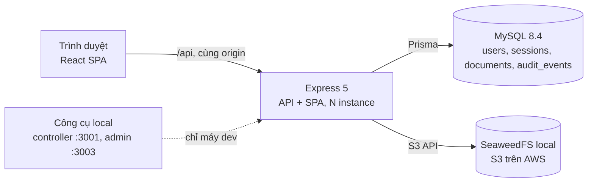

# PROJECT OVERVIEW — Kho Tài Liệu Học Tập (BTL Cloud, INT3319)

Điểm bắt đầu cho thành viên nhóm: bài toán, yêu cầu, ma trận quyền, trạng thái và phân công. Thiết kế và hợp đồng API: [ARCHITECTURE](ARCHITECTURE.md). Tiến độ, CR, nghiệm thu: [MILESTONES](MILESTONES.md). Cách chạy: [README](../README.md).

## 0. Đọc nhanh (10 phút)

### 0.1 Hệ thống làm gì

- Website lưu trữ và chia sẻ PDF/DOCX/PPTX ≤ 50 MiB. **Public**: ai cũng tìm và xem metadata, phải đăng nhập mới tải. **Private**: chỉ chủ sở hữu thấy.
- Chín yêu cầu FR-01…09 (§4): tài khoản, tìm kiếm, tải xuống cần đăng nhập, tải lên, chọn Public/Private, kho cá nhân, sửa, thay tệp, xoá.
- Mục tiêu học phần là triển khai và demo kiến trúc AWS đủ 8 hạng mục (§1).

### 0.2 Kiến trúc tổng thể



- Modular monolith một process; phiên lưu DB nên instance stateless. Local → AWS (ALB + ASG + RDS + S3) chỉ đổi biến môi trường.
- Ghi object trước rồi mới ghi DB; xoá object best-effort, lỗi ghi log `storage.orphan`; thay tệp đồng thời thì lần sau thắng ([§A6](ARCHITECTURE.md#a6-object-storage-và-vòng-đời-tài-liệu)).
- Phân quyền tài liệu chỉ nằm ở `document.policy.ts`: Private của người khác → 404, sửa trái phép tài liệu Public → 403 ([§A5.5](ARCHITECTURE.md#a55-phân-quyền-phía-server)).
- Không JWT, không CORS, không token trong localStorage, không vai trò admin trong `users`. Admin là công cụ local trong thư mục gitignore ([§A12](ARCHITECTURE.md#a12-mở-rộng-e1e8)).

### 0.3 Trạng thái

Nguồn: [MILESTONES](MILESTONES.md) (cập nhật lần cuối 30/10/2026). Khi trạng thái ở đó đổi, sửa bảng này trong cùng PR.

| Trạng thái | Nội dung |
|---|---|
| Xong | M0 thiết kế; M1–M3 backend, DB, storage, frontend; M4 kiểm chứng local (trừ 07/08); E1–E3, E6–E8 đã triển khai (admin local, quản lý/xoá user, số liệu và thử tải, chỉ báo mật khẩu, audit và chẩn đoán lỗi) |
| Chờ owner | M4-12 diễn tập demo, M4-G; E1-07 sao lưu admin; nghiệm thu E1-G, E2-G, E3-G, E6-G, E7-G |
| Chưa làm | M5-01…10 chuẩn bị AWS, M5-G; Docker thật (M1-00, M1-03) |
| Hoãn | M4-07 dừng storage thật, M4-08 nhiều instance (CR-005); E4–E5 hồ sơ, username, bạn bè (XOD-21) |
| Lỗi mở | SEC-002: advisory HIGH chuỗi Prisma CLI → deepmerge-ts |

### 0.4 Việc tiếp theo

1. M4-12 diễn tập demo và M4-G (owner).
2. M5-01 → M5-10 chuẩn bị AWS theo phân công §8, rồi M5-G.
3. Các gate E còn lại khi owner có thời gian; không để chúng chiếm thời gian của M5.

### 0.5 Lệnh thường dùng

```sh
npm --prefix backend run dev:account -- ten_cua_ban   # lần đầu: tài khoản developer
run.bat start          # hoặc Start.vbs; Docker: xem README
run.bat status         # trạng thái + log đã lọc bí mật
curl http://localhost:3000/api/health         # liveness
curl http://localhost:3000/api/health/ready   # DB + storage
npm ci && npm run lint && npm run build && npm test   # giống CI
npm --prefix backend run test:integration             # cần MySQL + SeaweedFS
npm --prefix frontend run test:e2e                     # cần stack :3000
node scripts/verify/authz-matrix.mjs                   # ma trận quyền
```

Web dev: http://localhost:5173. Admin (chỉ máy owner): http://localhost:5173/admin.

### 0.6 Tìm gì ở đâu

| Cần | Xem |
|---|---|
| Yêu cầu, quyền, quy tắc nghiệp vụ | §3–§4 tài liệu này |
| Module: input/output, phụ thuộc, lỗi | [§A3.3](ARCHITECTURE.md#a33-đặc-tả-module), [§A12.3](ARCHITECTURE.md#a123-module) |
| API, mã lỗi, DTO | [§A7](ARCHITECTURE.md#a7-rest-api-contract) |
| Schema DB | [§A4](ARCHITECTURE.md#a4-cơ-sở-dữ-liệu) |
| Biến môi trường, cổng, AWS | [§A10](ARCHITECTURE.md#a10-local-và-aws) |
| Task, bằng chứng, CR | [MILESTONES](MILESTONES.md) |

**Khi một quyết định đã duyệt thay đổi:** ghi CR ở MILESTONES → sửa đúng một chỗ (yêu cầu ở đây, thiết kế ở ARCHITECTURE, task ở MILESTONES) → nếu chạm trạng thái hoặc lệnh chạy thì sửa §0 trong cùng PR. Các tài liệu khác chỉ dẫn link, không chép lại.

## 1. Bài toán và mục tiêu học phần

Tài liệu học tập nằm rải rác trên máy cá nhân, nhóm chat và nhiều dịch vụ, nên khó tìm lại, khó chia sẻ có chọn lọc và dễ mất. Hệ thống giải quyết bằng lưu trữ tập trung, chia sẻ có kiểm soát (Public/Private) và tìm kiếm theo từ khoá. Guest tìm xem có tài liệu phù hợp trước khi đăng ký; User tải lên, quản lý kho cá nhân và tải xuống.

**Hướng dẫn học phần:** CLO4 (80%) chấm 8 hạng mục: (1) mạng riêng có subnet public/private trên ≥ 2 AZ; (2) máy chủ ứng dụng trong private subnet; (3) ≥ 2 loại lưu trữ; (4) một cơ sở dữ liệu; (5) IAM Role, không nhúng access key; (6) cân bằng tải và tự mở rộng, demo được khi tải tăng; (7) giám sát với ≥ 1 alarm được kích hoạt thử; (8) dự toán chi phí tháng. CLO2 (20%): giải thích được lý do mọi lựa chọn công nghệ. Sản phẩm phải chạy được và demo trong 10 phút.

| Thành phần cloud | Lý do |
|---|---|
| Object storage dùng chung (S3; local SeaweedFS) | Tệp tới 50 MB; tải lên qua instance A phải tải xuống được qua instance B |
| CSDL quan hệ (RDS MySQL) | Người dùng, phiên, tài liệu, quan hệ sở hữu cần ràng buộc toàn vẹn và truy vấn lọc/phân trang |
| Compute mở rộng ngang (EC2 + ALB + ASG) | Tải dao động theo mùa thi; ứng dụng stateless nên thêm/bớt instance không mất phiên |
| Block storage (EBS) | Ổ hệ điều hành và vùng đệm tạm khi nhận tệp upload |

Nguồn gốc: đề xuất đã nộp `pdf/Đề xuất BTL Cloud Trần Anh Việt 24020362.pdf` và `pdf/Bài tập lớn cuối kỳ - Hướng dẫn.pdf` (thư mục `pdf/` không theo Git, nhóm chia sẻ riêng).

## 2. Phạm vi

| Nhóm | MVP |
|---|---|
| Tài khoản | Đăng ký (email, mật khẩu, tên hiển thị), đăng nhập, đăng xuất; phiên qua cookie |
| Khám phá | Guest/User tìm và duyệt tài liệu Public (từ khoá, loại tệp, sắp xếp, phân trang); xem chi tiết |
| Tải xuống | User tải tài liệu Public của bất kỳ ai và Private của mình |
| Tải lên | PDF/DOCX/PPTX ≤ 50 MB; bắt buộc chọn Public/Private |
| Kho cá nhân | Danh sách của tôi; sửa tiêu đề/mô tả/chế độ; thay tệp (giữ chế độ); xoá vĩnh viễn |
| Vận hành | Health check, log có cấu trúc, nhiều instance dùng chung DB và storage |

**Ngoài phạm vi:** bình luận, đánh giá, theo dõi, chia sẻ cho người cụ thể, nhóm lớp; tìm kiếm toàn văn, gợi ý, xem trước tệp; quét virus, kiểm duyệt; quên/đổi mật khẩu, xác minh email, SSO; thùng rác, lịch sử phiên bản; hạn mức dung lượng; app di động, đa ngôn ngữ. Quản trị local, xoá tài khoản và thống kê được thêm qua phần mở rộng (§7).

| Giai đoạn | Nội dung |
|---|---|
| Local prototype (M1–M4) | Backend + frontend; MySQL và SeaweedFS bằng Docker Compose hoặc `run.bat` |
| Chuẩn bị AWS (M5) | Kế hoạch EC2/ALB/ASG/RDS/S3/IAM/CloudWatch, thử tải, chi phí; chốt HTTPS và egress |
| Triển khai AWS | Dựng hạ tầng thật, demo 8 hạng mục; cần owner cho phép (M5-G) |

## 3. Tác nhân và ma trận quyền

- **Guest**: không có phiên hợp lệ. **User**: có phiên hợp lệ. **Owner**: User có `users.id = documents.owner_id`, kiểm ở **mỗi** request.
- **Developer**: tài khoản công cụ local, không phải bản ghi `users` ([§A5.9](ARCHITECTURE.md#a59-xác-thực-công-cụ-developer-local)).

| Hành động | Guest | User không phải owner | Owner |
|---|---|---|---|
| Tìm kiếm / xem metadata tài liệu Public | ✅ | ✅ | ✅ |
| Tải xuống tài liệu Public | ❌ 401 | ✅ | ✅ |
| Xem / tải tài liệu Private của **mình** | — | — | ✅ |
| Xem / tải tài liệu Private của **người khác** | ❌ xem 404 · tải 401 | ❌ 404 | — |
| Thấy tài liệu Private trong tìm kiếm công khai | ❌ | ❌ | ❌ (chỉ trong kho cá nhân) |
| Tải lên | ❌ 401 | ✅ (trở thành owner) | ✅ |
| Xem kho cá nhân | ❌ 401 | ✅ (chỉ của mình) | ✅ |
| Sửa metadata / đổi chế độ, thay tệp, xoá | ❌ 401 | ❌ Public 403 · Private 404 | ✅ |

Private của người khác được đối xử **như không tồn tại** (404) để không lộ sự tồn tại; Public vốn công khai nên thao tác trái phép trả 403. Ma trận này được kiểm bằng `scripts/verify/authz-matrix.mjs`.

## 4. Yêu cầu chức năng

### 4.1 Quy tắc nghiệp vụ

| ID | Quy tắc |
|---|---|
| BR-01 | Tài liệu Private chỉ owner xem metadata và tải xuống được |
| BR-02 | Chỉ owner được sửa, thay tệp, xoá |
| BR-03 | Guest được tìm và xem metadata tài liệu Public, **không** được tải xuống |
| BR-04 | Khi tải lên phải chọn tường minh Public/Private; không có mặc định |
| BR-05 | Chỉ PDF, DOCX, PPTX; 1 byte … 52 428 800 byte (50 × 1024²); loại tệp xác minh theo **nội dung** |
| BR-06 | Upload dở dang/thất bại không bao giờ xuất hiện ở danh sách, tìm kiếm hay endpoint nào |
| BR-07 | Thay tệp giữ nguyên chế độ hiển thị; thay thất bại thì tệp cũ vẫn tải được |
| BR-08 | Xoá là vĩnh viễn: metadata mất ngay; object được thử xoá ngay (best-effort, lỗi ghi log `storage.orphan`) |
| BR-09 | Mọi xác thực và phân quyền thực thi ở backend; UI ẩn/hiện nút chỉ để tiện |
| BR-10 | Email là định danh đăng nhập, duy nhất, không phân biệt hoa thường |
| BR-11 | Tìm kiếm công khai chỉ trả tài liệu Public (kể cả của chính người tìm) |

### 4.2 Danh sách FR và tiêu chí chấp nhận

| FR | Nội dung | Tiêu chí chấp nhận |
|---|---|---|
| FR-01 Đăng ký, đăng nhập, đăng xuất | Đăng ký xong tự đăng nhập; phiên 7 ngày cố định, cookie HttpOnly; email ≤ 254, trim + chữ thường; mật khẩu 8–128; tên hiển thị 1–100 | AC-01.1 đăng ký xong vào "Tài liệu của tôi", header hiện tên · AC-01.2 email trùng (khác hoa thường) → "Email đã được sử dụng" · AC-01.3 sai mật khẩu và email không tồn tại → cùng một thông báo · AC-01.4 sau đăng xuất cookie cũ → 401 · AC-01.5 `document.cookie` và localStorage không có token · AC-01.6 DB không lưu mật khẩu rõ |
| FR-02 Tìm và duyệt Public | Từ khoá ≤ 100 khớp chuỗi con trong tiêu đề/mô tả, không phân biệt hoa thường/dấu; `%`, `_` theo nghĩa đen; mới nhất trước, 12 mục/trang; không lộ email người đăng | AC-02.1 Guest tìm được theo một từ trong tiêu đề · AC-02.2 Private không bao giờ xuất hiện · AC-02.3 tìm "%" không trả toàn bộ · AC-02.4 chi tiết Private của người khác → "Không tìm thấy" · AC-02.5 URL giữ từ khoá và trang |
| FR-03 Đăng nhập để tải xuống | Tệp chỉ phục vụ qua backend; tên gốc tiếng Việt giữ đúng; storage không bao giờ public | AC-03.1 Guest bấm tải → đăng nhập xong quay lại đúng trang · AC-03.2 gọi URL tải khi chưa đăng nhập → 401 · AC-03.3 checksum trùng tệp gốc · AC-03.4 B tải Private của A → 404 · AC-03.5 không URL storage nào truy cập được nếu không qua backend |
| FR-04 Tải lên ≤ 50 MB | Tiêu đề 1–200 (không xuống dòng, tự điền từ tên tệp); mô tả ≤ 2000; có tiến độ và huỷ; > 50 MB → 413, giả đuôi → 415 | AC-04.1 tải được mỗi loại · AC-04.2 52 428 800 byte nhận, +1 byte từ chối · AC-04.3 tệp văn bản đổi đuôi `.pdf` bị từ chối · AC-04.4 storage ngừng → lỗi, không có tài liệu "ma" · AC-04.5 tên tiếng Việt giữ đúng |
| FR-05 Chọn tường minh Public/Private | Form không chọn sẵn; mỗi lựa chọn có mô tả hệ quả | AC-05.1 mở form không radio nào được chọn · AC-05.2 API thiếu `visibility` → 400 · AC-05.3 Private không có trong tìm kiếm, Public thì có |
| FR-06 Kho cá nhân | Mọi tài liệu của mình, lọc chế độ/loại, phân trang; tải, sửa, xoá từ đây | AC-06.1 A và B chỉ thấy của mình · AC-06.2 lọc "Riêng tư" chỉ hiện Private · AC-06.3 vào `/me/documents` khi chưa đăng nhập → trang đăng nhập |
| FR-07 Sửa tiêu đề, mô tả, chế độ | Đổi chế độ có hiệu lực ngay; Private → Public phải xác nhận | AC-07.1 đổi tiêu đề → tìm theo tiêu đề mới thấy · AC-07.2 Public → Private biến mất khỏi tìm kiếm ngay, người khác tải → 404 · AC-07.3 người khác sửa Public → 403, Private → 404 |
| FR-08 Thay tệp | `id`, metadata, chế độ giữ nguyên; `fileVersion` + 1; lỗi → vẫn trỏ tệp cũ; đồng thời → lần sau thắng | AC-08.1 tải xuống ra nội dung mới, tiêu đề/chế độ không đổi · AC-08.2 storage ngừng giữa chừng → vẫn ra nội dung cũ · AC-08.3 object cũ không còn trong bucket (trừ khi có log `storage.orphan`) |
| FR-09 Xoá vĩnh viễn | Hộp thoại nêu "không thể hoàn tác"; storage lỗi vẫn báo thành công, log `storage.orphan` | AC-09.1 sau xoá, chi tiết/tải → 404 với mọi người · AC-09.2 object không còn khi storage hoạt động · AC-09.3 bấm "Huỷ" → không thay đổi gì |

Ánh xạ FR → UC → API → trang: [§A2](ARCHITECTURE.md#a2-use-case-và-truy-vết).

## 5. Yêu cầu phi chức năng

**M** = bắt buộc từ đề bài/đề xuất · **P** = mục tiêu do thiết kế đặt ra. Không có con số hiệu năng bịa ra; số liệu tải đo ở M5.

| Nhóm | Yêu cầu | Loại |
|---|---|---|
| Bảo mật | Phân quyền ở backend theo §3 (M); argon2id; phiên opaque trong cookie HttpOnly, DB chỉ lưu hash; chống CSRF; bucket private, tải qua backend; kiểm loại tệp theo nội dung; header bảo mật; HTTPS + cookie `Secure` trên production (chốt ở M5) | M + P |
| Không access key trong mã | Dùng IAM Role trên AWS | M |
| Sẵn sàng | Tầng ứng dụng ≥ 2 instance trên 2 AZ sau ALB (M); RDS Single-AZ là điểm lỗi đơn được chấp nhận; liveness không phụ thuộc DB/storage | M + P |
| Tin cậy | Upload thất bại không hiển thị; thay thất bại giữ tệp cũ (M); lỗi xoá object ghi log `storage.orphan`; tắt êm khi SIGTERM | M + P |
| Mở rộng | Nhiều instance dùng chung DB/storage (M); ASG mở rộng khi tải tăng, demo được (M); upload không đệm toàn bộ tệp trong RAM | M + P |
| Bảo trì | TypeScript strict, modular monolith, lint trong CI; hợp đồng API duy nhất ở §A7; unit, integration, E2E cho luồng chính | P |
| Dễ dùng | UI tiếng Việt, lỗi rõ ràng, dùng được từ 360 px, hướng tới WCAG 2.1 AA; upload có tiến độ và huỷ | P |
| Quan sát | CloudWatch có ≥ 1 alarm kích hoạt thử (M); log JSON có `requestId`, `instanceId`, không ghi bí mật; health trả `instanceId` | M + P |
| Di chuyển | Local → AWS chỉ đổi cấu hình (M); cấu hình qua biến môi trường, kiểm khi khởi động | M + P |
| Chi phí | Dự toán chi phí tháng theo kiến trúc cuối | M |

## 6. Ràng buộc, rủi ro, quyết định

**Ràng buộc tệp:** PDF, DOCX, PPTX (không DOC/PPT cũ, Office có mật khẩu, tệp nén); 50 MB = 52 428 800 byte; mỗi request đúng 1 tệp; không quét virus. **Giả định:** Windows 11, Node.js 24, npm 11; Docker tuỳ chọn; quy mô demo vài chục người dùng, vài trăm tài liệu; AWS cá nhân có credits, region `us-east-1`.

| ID | Rủi ro | Giảm thiểu |
|---|---|---|
| RK-01 | DB và storage không có transaction chung → object mồ côi | Ghi object trước DB; xoá best-effort + log; chấp nhận mồ côi (CR-007) |
| RK-02 | Sai phân quyền làm lộ Private | Policy tập trung một chỗ; test tự động ma trận §3 |
| RK-03 | Tệp lớn qua ALB/Node bị timeout | Timeout ở [§A10.4](ARCHITECTURE.md#a104-timeout-và-giới-hạn-kiểm-chứng-ở-m5); thử ở M5 |
| RK-04 | Không có HTTPS → cookie đi qua kênh không mã hoá | Chốt OD-05; nếu chỉ HTTP thì ghi là rủi ro chấp nhận cho demo |
| RK-05 | App chủ yếu chờ I/O, CPU khó tăng → khó kích hoạt ASG khi demo | Chọn metric phù hợp + thử tải trước (OD-09) |
| RK-11 | Chi phí AWS ngoài dự toán (NAT, endpoint, tên miền, IPv4, t3 unlimited) | Rà soát M5-09 trước khi provisioning |

| ID | Quyết định | Trạng thái |
|---|---|---|
| OD-01, 13, 14 | Stack React/Vite + Node 24/Express 5/Prisma + MySQL 8.4 + SeaweedFS (thay MinIO); Docker hoặc `run.bat` | Đã chốt |
| OD-02, 03, 04 | 50 MB = 52 428 800 byte; Private người khác 404, Public trái phép 403; đăng ký xong tự đăng nhập | Đã chốt |
| OD-10, 11, 12 | Giữ trang chi tiết + lọc loại tệp; xoá object cũ ngay sau UPDATE (không ân hạn); phiên cố định 7 ngày | Đã chốt |
| OD-08 | Sửa `.github/workflows/ci.yml` để chạy integration test | Chờ owner duyệt PR |
| OD-05 | Production dùng HTTPS (tên miền + ACM) hay HTTP qua DNS của ALB | M5 |
| OD-06 | Egress cho EC2 private: chỉ S3 Gateway Endpoint / Interface Endpoint / NAT | M5 |
| OD-07 | Cách cấp mật khẩu RDS cho EC2 (SSM Parameter Store, user data…) | M5 |
| OD-09 | Metric ASG: CPU hay `ALBRequestCountPerTarget` | M5 sau thử tải |

**Sai lệch nguồn cần xử lý ở M5:** bảng chi phí trong đề xuất ghi 63,96 USD/tháng nhưng ảnh Pricing Calculator ghi 56,05 USD (DS-03); sơ đồ có S3 VPC Endpoint nhưng phần chữ/chi phí không nhắc, không có NAT, và dòng "Public IPv4 × 2" mâu thuẫn với EC2 private (DS-04).

## 7. Mở rộng E1–E8

Đã duyệt qua CR-009 (30/10/2026), là phần **tuỳ chọn**, không thay điều kiện của bài tập cloud. Nguyên tắc: đơn giản nhất có thể, không thêm dịch vụ mới. Thiết kế: [§A12](ARCHITECTURE.md#a12-mở-rộng-e1e8).

| Giai đoạn | Nội dung | Trạng thái |
|---|---|---|
| E1 Admin local | Trang `/admin` chỉ trên máy owner (Vite :5173), cần đăng nhập developer; panel dịch vụ cũ chuyển vào đây; dashboard số user (registered/active 15 phút, 24 giờ, 7 ngày), tài liệu, dung lượng logic và đĩa SeaweedFS, sức khoẻ dịch vụ | Đã làm; chờ E1-07, E1-G |
| E2 Quản lý user | Tìm (20/trang), xem, sửa email/tên hiển thị, thu hồi phiên, xoá vĩnh viễn tài khoản (gõ lại email để xác nhận; lỗi giữa chừng thì "Tiếp tục xoá") | Đã làm; chờ E2-G |
| E3 Hiệu năng | Req/s, đang xử lý, P50/P95, 4xx/5xx trong 5 phút; CPU/RAM/event loop; script thử tải trên DB riêng; không thêm cache | Đã làm; chờ E3-G |
| E4–E5 | Hồ sơ/avatar, username, tìm người dùng, bạn bè | **Hoãn** (XOD-21); làm lại cần CR mới |
| E6 Chỉ báo mật khẩu | Ba tiêu chí (chữ hoa, ký tự đặc biệt, > 12 ký tự) → Quá ngắn / Yếu / Trung bình / Mạnh; chỉ tham khảo, không chặn đăng ký | Đã làm; chờ E6-G |
| E7 Audit và lỗi | Bảng `audit_events` ghi ai làm gì (giữ 90 ngày); log có `module`, `stage`, `code`; admin xem Activity, Errors, tra theo `requestId` | Đã làm; chờ E7-G |
| E8 Khôi phục ngữ cảnh | Mục §0 của tài liệu này | Xong |

Quy tắc chung của phần mở rộng:
- Admin là tiến trình riêng, chỉ trên máy owner; mã admin bị `.gitignore`, không có trong bản build, không lên AWS. Clone sạch vẫn build, test, chạy bình thường. `/api/admin/*` trên app public → 404.
- Không API nào trả `password_hash`, token phiên, khoá S3, chuỗi kết nối DB.
- Tài khoản đang bị xoá (`DELETING`) coi như không tồn tại: không đăng nhập được, tài liệu không hiển thị.
- Không reset DB; migration chỉ thêm cột/bảng; sao lưu trước khi áp.
- Audit không ghi mật khẩu, email (trừ email đã che khi xoá tài khoản), tiêu đề, IP; đăng nhập sai ghi actor ẩn danh. Chỉ developer qua admin local đọc được audit.

## 8. Bàn giao nhóm và AWS

Ứng dụng local đã đủ để làm tiếp phần cloud. CLO4 (80% điểm) yêu cầu hạ tầng chạy và demo được; mỗi người phải giải thích được phần mình và kiến trúc tổng thể.

### 8.1 Bắt đầu trên máy mình

Cài Node.js 24 và Git, rồi:

```powershell
git clone https://github.com/august0362/btl_cloud.git BTL_Cloud
cd BTL_Cloud
npm ci
npm --prefix backend run dev:account -- ten_cua_ban
.\run.bat start
```

Lần đầu launcher tải MySQL/SeaweedFS portable, tạo `.env`, chạy migration, tạo bucket (cần mạng). Tài khoản website tạo ở `/register`. Git không mang theo DB, phiên, tài liệu đã tải lên, `.env` hay `backend/tmp/`. Máy không có thư mục admin dùng `run.bat start`/`stop` thay cho trang `/admin`.

### 8.2 Phân công (theo đề xuất đã nộp)

| Thành viên | Việc | Đầu ra |
|---|---|---|
| Trần Anh Việt | VPC, 2 AZ, 2 public + 2 private subnet, routing, security group, ALB; phối hợp S3 VPC Endpoint; điều phối tích hợp | Sơ đồ mạng; ALB truy cập được app trên EC2 private; danh sách endpoint/cấu hình bàn giao |
| Trương Công Mạnh | Kiểm chứng backend (đăng nhập, upload, tìm kiếm, phân quyền); chạy app trên EC2 với RDS/S3 | Artifact build, cách khởi động, biến môi trường, bước migration, bằng chứng luồng nghiệp vụ trên AWS |
| Dương Quân Bảo | RDS MySQL, S3 private, EBS, IAM Role cho EC2 | Endpoint RDS, bucket/region, cấu hình quyền; EC2 truy cập được RDS/S3; giải thích EBS và S3 dùng cho việc gì |
| Phạm Đức Trọng | Launch template/ASG (2 EC2, tối đa 4) cùng Việt; CloudWatch, alarm, thử tải, dự toán | Kịch bản tải, bằng chứng scale-out, alarm đã kích hoạt, bảng chi phí theo cấu hình thực tế |

### 8.3 Thứ tự thực hiện

1. Cả nhóm chạy lại demo local: đăng nhập → upload → tìm kiếm → Public/Private (M4-12).
2. Chốt OD-05/06/07/09 (§6): HTTP/HTTPS, egress cho EC2 private, cách cấp bí mật RDS, metric scale-out.
3. Việt chuẩn bị mạng/ALB, Bảo dữ liệu/storage/IAM, Mạnh bản chạy production. Thống nhất tên tài nguyên, region, SG, cổng, endpoint trước khi ghép.
4. Khi app chạy ổn qua ALB, Trọng cùng Việt hoàn thiện ASG, alarm, thử tải; kiểm đăng nhập/upload/download vẫn đúng khi qua nhiều instance.
5. Mỗi người lưu cấu hình, ảnh/log, kết quả; cả nhóm ghép báo cáo, video, diễn tập.

Cấu hình triển khai mới để trong `deploy/` (chưa có). Mỗi việc một nhánh `feature/*` (vd. `feature/aws-network`, `feature/aws-storage-iam`); PR ghi việc đã làm, cách chạy, cấu hình bàn giao và bằng chứng; vào `main` cần `ci-required` và code owner review.

### 8.4 Điều kiện hoàn thành và demo

Lưu bằng chứng cho từng hạng mục: VPC public/private trên 2 AZ · app ở private subnet, truy cập qua ALB · EBS và S3, giải thích lựa chọn · RDS MySQL chạy cùng app · EC2 dùng IAM Role, không access key · ALB/ASG scale-out quan sát được khi tăng tải · CloudWatch alarm đã kích hoạt thử · dự toán chi phí tháng theo cấu hình thực tế (đối chiếu lại 63,96 / 56,05 USD).

Kịch bản demo 10 phút: 0–2 kiến trúc · 2–5 nghiệp vụ · 5–7 storage/DB/IAM · 7–9 tải/ASG/alarm · 9–10 chi phí. Thử trước và lưu lịch sử scale-out phòng khi khởi tạo instance chậm.

Mốc học phần (hướng dẫn PDF, trang 3): **09/11/2026** nộp báo cáo cuối, mã nguồn/cấu hình, video demo; **16/11/2026** bảo vệ, vấn đáp.

## Thuật ngữ

| Thuật ngữ | Nghĩa |
|---|---|
| Guest / User / Owner | Chưa đăng nhập / đã đăng nhập / User sở hữu tài liệu đang xét |
| Metadata / Object | Thông tin tài liệu trong MySQL / byte của tệp trong object storage |
| Liveness / Readiness | `/api/health` (process còn sống) / `/api/health/ready` (DB + storage sẵn sàng) |
| Object mồ côi | Object không còn bản ghi `documents` nào trỏ tới, do lỗi giữa DB và storage |
| Developer / Admin local | Tài khoản công cụ local / trang `/admin` chỉ có trên máy owner |
| ID | `FR`, `BR`, `AC`, `OD`, `RK`: tài liệu này · `D`, `UC`, `API`, `P`, `SEQ`, `XD`, `XM`, `XA`, `ADM`: ARCHITECTURE · `M<n>-xx`, `E<n>-xx`, `CR`, `ACC`: MILESTONES |
