# PROJECT OVERVIEW — Kho Tài Liệu Học Tập (BTL Cloud, INT3319)

Tài liệu đọc liền mạch cho thành viên nhóm: bài toán, thành phần, dữ liệu, API và luồng xử lý. Chi tiết chuẩn: [CONTEXT](CONTEXT.md) giữ yêu cầu/tiêu chí chấp nhận; [ARCHITECTURE §A7](ARCHITECTURE.md#a7-rest-api-contract) giữ hợp đồng API; [MILESTONES](MILESTONES.md) giữ tiến độ và nghiệm thu.

Bản này dựa trên main `31e51a7` (29/10/2026). Các sơ đồ Mermaid được GitHub tự vẽ; trong VS Code dùng extension `bierner.markdown-mermaid`.

**Đọc nhanh:** [Hướng dẫn 10 phút](#0-project-re-entry--hướng-dẫn-10-phút) · [Kiến trúc](#6-kiến-trúc) · [Dữ liệu](#7-dữ-liệu-và-lưu-trữ) · [Bảo mật](#8-xác-thực-phân-quyền-bảo-mật) · [API](#9-đặc-tả-rest-api) · [Luồng xử lý](#10-luồng-xử-lý-chính) · [Chạy local](#12-môi-trường-local-và-cấu-hình) · [AWS](#13-kiến-trúc-aws-mục-tiêu-m5-chưa-triển-khai) · [Kiểm chứng](#14-kiểm-thử-ci-và-tiến-độ).

## 0. Project Re-entry — Hướng dẫn 10 phút

> Đọc mục này đầu tiên khi quay lại dự án sau một thời gian. Mục này chỉ tóm tắt và dẫn link; khi mâu thuẫn, [CONTEXT](CONTEXT.md), [ARCHITECTURE](ARCHITECTURE.md), [MILESTONES](MILESTONES.md) thắng. Đã đối chiếu mã ở commit `80dc3a9` (30/10/2026). Việc duy trì mục này là giai đoạn E8 (đã duyệt, CR-009) ([MILESTONES › E8](MILESTONES.md#e8--khôi-phục-ngữ-cảnh-dự-án)).

### 0.1 Mục đích và yêu cầu cốt lõi

- Website lưu trữ và chia sẻ tài liệu học tập PDF/DOCX/PPTX ≤ 50 MiB. **Public**: ai cũng tìm và xem metadata, phải đăng nhập mới tải. **Private**: chỉ chủ sở hữu thấy.
- Chín yêu cầu FR-01…09: tài khoản, tìm kiếm, tải xuống cần đăng nhập, tải lên, chọn Public/Private, kho cá nhân, sửa, thay tệp, xoá ([CONTEXT §C4](CONTEXT.md#c4-yêu-cầu-chức-năng)).
- Mục tiêu học phần là kiến trúc AWS 8 hạng mục ([CONTEXT §C1](CONTEXT.md#c1-tổng-quan)). Hạn: **09/11/2026** nộp báo cáo, mã nguồn, video; **16/11/2026** bảo vệ.

### 0.2 Kiến trúc tổng thể

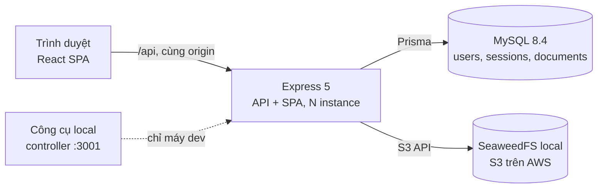

Modular monolith một process (D-01). Phiên lưu DB nên instance stateless. Từ local lên AWS (ALB + ASG + RDS + S3) chỉ đổi cấu hình, chưa provisioning ([§13](#13-kiến-trúc-aws-mục-tiêu-m5-chưa-triển-khai)).

### 0.3 Module chính — tự kiểm tra ba câu

Với mỗi module, tự trả lời: **input/output là gì? phụ thuộc vào gì? lỗi thì sao?** Bảng dưới là đáp án ngắn; đặc tả đầy đủ ở [ARCHITECTURE §A3.6](ARCHITECTURE.md#a36-đặc-tả-module).

| Module | Input → Output | Phụ thuộc | Khi lỗi |
|---|---|---|---|
| `http/middleware` | request → `req.id`, `req.auth` | config, AuthService | 403 CSRF, 401, 429, 404 |
| `http/errorHandler` | Error → envelope JSON có `requestId` | logger | Lỗi lạ → 500, log stack |
| `modules/auth` + `users` | email, mật khẩu → `UserDto` + cookie phiên | repositories, argon2 | `INVALID_CREDENTIALS`, `EMAIL_ALREADY_EXISTS` |
| `documents` (service, loader, policy) | DTO, tệp đã kiểm → `DocumentDto`, stream | DocumentRepository, ObjectStorage | 403/404 theo quyền; `STORAGE_UNAVAILABLE` |
| `files` (upload, FileInspector) | multipart → tệp tạm đã xác minh loại | multer, yauzl | 413, 415, 400 |
| `storage` | key, tệp → object / stream | AWS SDK v3 | `StorageError` UNAVAILABLE / NOT_FOUND |
| `modules/health` | — → liveness / readiness | Prisma, ObjectStorage | Liveness luôn 200; readiness 503 |
| `config/env` | `process.env` → `Config` | zod | Thiếu biến → thoát |
| Frontend `api/` | tham số → dữ liệu có type | fetch, XHR | `ApiError`, `NETWORK_ERROR` |
| Frontend `auth/` | API-03 → user, guard route | `api/auth` | 401 → Guest + toast |
| `backend/dev` (controller, launcher) | lệnh Start/Stop → dịch vụ local, log | developer auth | Chỉ dev; không lên AWS |

### 0.4 Ba luồng quan trọng

| Luồng | Tóm tắt | Chi tiết |
|---|---|---|
| Xác thực | Đăng ký/đăng nhập → băm argon2id → token phiên 32 byte trong cookie HttpOnly `sid` 7 ngày; DB chỉ lưu SHA-256 của token. Mỗi request nạp phiên; request ghi phải có `X-CSRF-Protection: 1` và `Origin` hợp lệ | [SEQ-01](ARCHITECTURE.md#seq-01--đăng-ký--đăng-nhập--đăng-xuất), [§A5](ARCHITECTURE.md#a5-xác-thực-và-phân-quyền) |
| Upload / download | Kiểm đăng nhập và quyền **trước** khi nhận tệp → ghi đĩa tạm → FileInspector xác minh loại theo nội dung → `putObject` → INSERT. Lỗi ở bất kỳ bước nào → không có tài liệu. Download: kiểm quyền → stream từ storage qua backend | [SEQ-02](ARCHITECTURE.md#seq-02--tải-lên-thành-công), [SEQ-03](ARCHITECTURE.md#seq-03--tải-lên-thất-bại), [SEQ-05](ARCHITECTURE.md#seq-05--tải-xuống-khi-đã-đăng-nhập) |
| Phân quyền | `document.policy` (`canView`, `canManage`) là nơi duy nhất quyết định. Private của người khác → 404; sửa trái phép tài liệu Public → 403; tìm kiếm lọc Public ngay trong SQL | [CONTEXT §C3.2](CONTEXT.md#c32-ma-trận-quyền), [§A5.5](ARCHITECTURE.md#a55-phân-quyền-phía-server) |

### 0.5 Bất biến và quyết định không được phá

- MySQL là nguồn sự thật; object key bất biến; ghi object trước rồi mới ghi DB (D-06, D-07, [§A6](ARCHITECTURE.md#a6-object-storage-và-vòng-đời-tài-liệu)).
- Xoá object là best-effort, lỗi ghi log `storage.orphan`; thay tệp đồng thời thì lần ghi sau thắng; không có worker (CR-007, D-08…D-10).
- [§A7](ARCHITECTURE.md#a7-rest-api-contract) là hợp đồng API duy nhất; đổi field hay mã lỗi phải qua CR.
- Không JWT, không CORS, không token trong localStorage; không có vai trò admin trong `users`.
- Liveness không phụ thuộc DB/storage (D-14). Khác biệt local/AWS chỉ nằm trong biến môi trường.
- **Cache:** chỉ có cache tài nguyên tĩnh production (`/assets/*` immutable 1 năm; `index.html` `no-cache`). API JSON `no-store`, tải xuống `private, no-store`. Không có Redis hay cache truy vấn phía server. Chỉ xét cache khi có số đo E3 ([CONTEXT §C8.9](CONTEXT.md#c89-ảnh-hưởng-tới-baseline-và-hiện-trạng-cache)).

### 0.6 Trạng thái hiện tại

Nguồn: [MILESTONES](MILESTONES.md#quy-tắc-và-milestone). Sửa bảng này khi trạng thái ở đó đổi.

| Trạng thái | Nội dung |
|---|---|
| DONE | M0 thiết kế (owner duyệt); M1–M3 backend, DB, storage, frontend đã triển khai; M4-01…06, M4-09…11 đã kiểm chứng local; E0, E1-01 (activity tracker), E1-02 (khung admin local, gitignore), E1-03 (controller chạy admin, proxy `/admin/*`), E1-04 (panel developer chuyển vào admin `/admin`), E1-05 (API số liệu admin), E1-06 (trang Dashboard admin), E2-01 (trạng thái DELETING), E2-02 (API quản lý user admin), E3-01 (đo hiệu năng), E6-01 (chỉ báo mật khẩu), E7-01 (bảng audit_events), E7-02 (audit route auth/documents), E7-03 (trường log chẩn đoán), E7-04 (API Activity/Errors admin), E8 (kiểm hướng dẫn §0, diễn tập, quy tắc cập nhật; owner nghiệm thu) |
| BLOCKED / chờ | M4-07, M4-08 hoãn (CR-005). M4-12, M4-G chờ owner. M5 chờ M4-G; provisioning AWS chờ M5-G. M1-00, M1-03 (Docker thật) và M3-01 chưa tick. SEC-002 (Prisma CLI) còn mở |
| NOT STARTED | M5-01…M5-10 |
| APPROVED, CÒN MỞ | E1–E3, E6–E8 (CR-009, 30/10/2026) còn task/gate; E6-G vẫn chờ owner, các tính năng admin, audit và metrics chưa hoàn thành |
| DEFERRED | E4–E5 hồ sơ, username, bạn bè (XOD-21) |

### 0.7 Chạy, kiểm tra sức khoẻ, test

```sh
npm --prefix backend run dev:account -- ten_cua_ban   # lần đầu: tài khoản developer
run.bat start          # hoặc Start.vbs; Docker: xem README
run.bat status         # trạng thái + log đã lọc bí mật
curl http://localhost:3000/api/health         # liveness
curl http://localhost:3000/api/health/ready   # DB + storage
npm ci && npm run lint && npm run build && npm test   # giống CI
npm --prefix backend run test:integration             # cần MySQL + SeaweedFS
node --test backend/dev/*.test.mjs                     # launcher/controller
npm --prefix frontend run test:e2e                     # cần stack :3000
node scripts/verify/authz-matrix.mjs                   # ma trận quyền
```

Web dev: http://localhost:5173. Chi tiết và lỗi thường gặp: [README](../README.md), [§12](#12-môi-trường-local-và-cấu-hình).

### 0.8 Ưu tiên tiếp theo

1. **M4-12** diễn tập demo và **M4-G** gate (owner).
2. **M5-01 → M5-10** chuẩn bị AWS, rồi **M5-G**.
3. E1–E3, E6–E8 đã duyệt; owner chọn từng task. Gợi ý: không để chúng chiếm thời gian của M5 trước hạn 09/11/2026.

### 0.9 Quy trình khôi phục ngữ cảnh

1. Đọc mục §0 này (10 phút).
2. Tìm module sẽ sửa và hợp đồng input/output của nó: [§A3.6](ARCHITECTURE.md#a36-đặc-tả-module) (MVP) hoặc [§A12.3](ARCHITECTURE.md#a123-module) (mở rộng đề xuất); API ở [§A7](ARCHITECTURE.md#a7-rest-api-contract).
3. Xem quyết định và phụ thuộc liên quan: [§A1.2](ARCHITECTURE.md#a12-quyết-định-thiết-kế), [§A1.4](ARCHITECTURE.md#a14-quy-tắc-phụ-thuộc), [CONTEXT §C6.6](CONTEXT.md#c66-quyết-định-cần-owner-xem-xét).
4. Đọc trạng thái mới nhất của task trong [MILESTONES](MILESTONES.md) và [Nhật ký thay đổi baseline](MILESTONES.md#nhật-ký-thay-đổi-baseline).
5. Chạy test liên quan (§0.7) **trước** khi sửa để biết điểm xuất phát.
6. Khi một quyết định đã duyệt thay đổi: ghi CR, sửa tài liệu nguồn và §0 trong cùng PR ([§A12.12](ARCHITECTURE.md#a1212-khôi-phục-ngữ-cảnh-và-điều-hướng-kiến-trúc-e8)).

## 1. Giới thiệu

Website cho học sinh, sinh viên lưu trữ, tìm kiếm và chia sẻ PDF/DOCX/PPTX, tối đa 50 MiB. Tài liệu **Public** cho mọi người tìm/xem metadata, cần đăng nhập để tải; **Private** chỉ chủ sở hữu truy cập được.

Mục tiêu học phần là triển khai và demo kiến trúc cloud, đồng thời giải thích được lựa chọn công nghệ. Ứng dụng local đã có; AWS chưa triển khai. PR #1 và #2 đã gộp code/tài liệu bàn giao vào main; M4-07/08 vẫn hoãn, M4-12/M4-G chờ owner nghiệm thu.

## 2. Phạm vi

### 2.1 MVP

| Nhóm | Chức năng |
|---|---|
| Tài khoản | Đăng ký email/mật khẩu/tên hiển thị; đăng nhập, đăng xuất; cookie phiên |
| Khám phá | Tìm tiêu đề/mô tả Public, lọc loại, sắp xếp, phân trang và xem chi tiết |
| Tệp | Upload/download; một PDF/DOCX/PPTX tối đa 52.428.800 byte |
| Kho cá nhân | Tài liệu của mình, Public/Private; sửa metadata, thay tệp, xoá |
| Vận hành | Health, log, kiểm thử; thiết kế nhiều instance dùng DB/storage chung |

### 2.2 Ngoài phạm vi

Chưa có nhóm chia sẻ, link có thời hạn, preview nội dung, quản trị người dùng, lịch sử phiên bản hoặc tìm kiếm full-text. Tài khoản developer chỉ mở công cụ local. Quản trị local và audit đã được duyệt thêm (E1–E3, E7, CR-009) nhưng chưa triển khai; hồ sơ, bạn bè (E4–E5) hoãn (§2.3).

### 2.3 Giai đoạn

M0 thiết kế; M1–M3 ứng dụng; M4 kiểm chứng local; M5 chuẩn bị AWS. Việc tạo tài nguyên cloud cần phạm vi riêng được owner chốt. Xem [MILESTONES](MILESTONES.md) trước khi nhận việc.

Mở rộng tuỳ chọn E1–E8 (CR-009): E1–E3, E6–E8 **đã duyệt**, chưa triển khai; E4–E5 **hoãn**. Không thay đổi M0–M5:

| Giai đoạn | Nội dung | Yêu cầu · Thiết kế · Task |
|---|---|---|
| E1–E3 | Admin local (tiến trình riêng, gitignore): dashboard, quản lý/xoá user, số liệu hiệu năng | [§C8.1–C8.3](CONTEXT.md#c81-e1--local-admin-dashboard) · [§A12](ARCHITECTURE.md#a12-mở-rộng-đề-xuất-e1e8) · [E1–E3](MILESTONES.md#e1--local-admin-dashboard) |
| E4–E6 | E4–E5 (hoãn): hồ sơ/avatar, username/tìm user/bạn bè · E6: chỉ báo mật khẩu | [§C8.4–C8.6](CONTEXT.md#c84-e4--hồ-sơ-người-dùng) · [§A12.3](ARCHITECTURE.md#a123-module) · [E4–E6](MILESTONES.md#e4--hồ-sơ-người-dùng) |
| E7 | Audit log (bảng `audit_events`) và chẩn đoán lỗi từ log sẵn có | [§C8.7](CONTEXT.md#c87-e7--audit-log-và-chẩn-đoán-lỗi) · [§A12.7](ARCHITECTURE.md#a127-audit-log-và-chẩn-đoán-lỗi-e7) · [E7](MILESTONES.md#e7--audit-log-và-chẩn-đoán-lỗi) |
| E8 | Hướng dẫn 10 phút (§0) và quy trình khôi phục ngữ cảnh | [§C8.8](CONTEXT.md#c88-e8--khôi-phục-ngữ-cảnh-dự-án) · [§A12.12](ARCHITECTURE.md#a1212-khôi-phục-ngữ-cảnh-và-điều-hướng-kiến-trúc-e8) · [E8](MILESTONES.md#e8--khôi-phục-ngữ-cảnh-dự-án) |

## 3. Tác nhân và ma trận quyền

Guest chưa đăng nhập; User đã đăng nhập; Owner là User sở hữu tài liệu đang xét.

| Hành động | Guest | User khác chủ | Owner |
|---|---|---|---|
| Tìm/xem Public | Có | Có | Có |
| Tải Public | 401 | Có | Có |
| Xem/tải Private | Xem 404, tải 401 | 404 | Có |
| Upload/kho cá nhân | 401 | Chỉ kho của mình | Có |
| Sửa/thay/xoá Public | 401 | 403 | Có |
| Sửa/thay/xoá Private | 401 | 404 | Có |


## 4. Yêu cầu chức năng

### 4.1 Quy tắc nghiệp vụ

- Private chỉ owner xem/tải; chỉ owner sửa/thay/xoá.
- Upload bắt buộc chọn Public/Private và kiểm nội dung tệp, không tin đuôi/MIME.
- Upload lỗi trước khi tạo metadata không xuất hiện trong danh sách; thay tệp lỗi trước UPDATE giữ tham chiếu cũ.
- Xoá metadata trước, xoá object best-effort; không có khôi phục hoặc hàng đợi tự thử lại.
- Phân quyền tại backend; email trim/chữ thường/duy nhất; tìm kiếm công khai không trả Private.

### 4.2 Danh sách FR

| FR | Tên | Nội dung chính | API | Trang |
|---|---|---|---|---|
| FR-01 | Đăng ký, đăng nhập, đăng xuất | Đăng ký xong tự đăng nhập; phiên 7 ngày, cookie HttpOnly; sai email/mật khẩu → **một** thông báo chung; email trùng → "Email đã được sử dụng" | API-03…06 | P-02, P-03, header |
| FR-02 | Tìm và duyệt tài liệu Public | Từ khoá ≤ 100 ký tự khớp chuỗi con trong tiêu đề/mô tả, không phân biệt hoa thường/dấu; `%`, `_` hiểu theo nghĩa đen; 12 mục/trang; không lộ email người đăng | API-07, 09 | P-01, P-04 |
| FR-03 | Bắt buộc đăng nhập để tải xuống | Tệp chỉ phục vụ qua backend; tên gốc tiếng Việt giữ đúng; nội dung khớp từng byte | API-03, 13 | P-01, P-04, P-05 |
| FR-04 | Tải lên PDF/DOCX/PPTX ≤ 50 MiB | Tiêu đề 1–200, mô tả ≤ 2000; có tiến độ và nút huỷ; > 50 MiB → 413, giả đuôi → 415; lỗi bất kỳ → không có tài liệu "ma" | API-10 | P-06 |
| FR-05 | Chọn tường minh Public/Private | Form không chọn sẵn; API thiếu `visibility` → 400 | API-10 | P-06 |
| FR-06 | Kho tài liệu cá nhân | Mọi tài liệu của mình, lọc theo chế độ/loại, phân trang | API-08 | P-05 |
| FR-07 | Sửa tiêu đề, mô tả, chế độ | Đổi chế độ có hiệu lực ngay; Private → Public phải xác nhận | API-11 | P-07 |
| FR-08 | Thay tệp, giữ chế độ | `id`, metadata, chế độ giữ nguyên; `fileVersion` + 1; lỗi → vẫn trỏ tệp cũ | API-12 | P-07 |
| FR-09 | Xoá vĩnh viễn | Xác nhận "không thể hoàn tác"; sau xoá mọi endpoint trả 404 | API-14 | P-04, P-05, P-07 |

Tiêu chí chấp nhận chi tiết (AC-01.1 … AC-09.3): [CONTEXT §C4](CONTEXT.md#c4-yêu-cầu-chức-năng).

## 5. Yêu cầu phi chức năng chính

| Nhóm | Yêu cầu và cách đáp ứng |
|---|---|
| Bảo mật | Argon2id, cookie HttpOnly, CSRF, phân quyền trước upload; bucket private và tải qua backend |
| Độ tin cậy | Object ghi trước metadata; bù trừ khi DB lỗi; log object mồ côi; graceful shutdown |
| Mở rộng | Phiên trong MySQL, tệp trong S3-compatible; tệp local chỉ là tạm theo request |
| Vận hành | Liveness/readiness tách riêng; log requestId/instanceId, không ghi bí mật |
| UI/kiểm thử | Tiếng Việt, từ 360 px, tiến độ/huỷ upload, keyboard/accessibility; unit/integration/E2E |
| AWS | Hai AZ, private app, ALB/ASG, IAM Role, alarm đã kích hoạt và dự toán theo cấu hình cuối |

Bảng đầy đủ 31 NFR, phân biệt bắt buộc (M) và mục tiêu thiết kế (P), ở [CONTEXT §C5](CONTEXT.md#c5-yêu-cầu-phi-chức-năng).

## 6. Kiến trúc

### 6.1 Technology stack (phiên bản ghim trong lockfile)

| Tầng | Lựa chọn / lý do |
|---|---|
| Frontend | React 19, TypeScript, Vite 8, React Router; SPA build tĩnh; CSS Modules/token |
| Backend | Node.js 24, Express 5, zod; lỗi async đi qua error middleware |
| DB | Prisma 6 + MySQL 8.4; migration có version, collation utf8mb4_0900_ai_ci |
| Tệp | AWS SDK v3/lib-storage; multer ghi đĩa tạm; yauzl kiểm cấu trúc Office ZIP |
| Bảo mật/log | Argon2id, helmet, cookie-parser, rate limit; pino JSON stdout |
| Test/local | Vitest, Supertest, RTL, Playwright; Docker hoặc MySQL/SeaweedFS portable |

### 6.2 Quyết định thiết kế chính

Modular monolith, production API + SPA cùng origin. Phiên opaque lưu DB để thu hồi và dùng chung instance. Upload/download qua backend giữ một điểm kiểm quyền; đổi lại băng thông đi qua EC2.

Object key bất biến; DB/storage không có transaction chung nên dùng bù trừ best-effort. Thay đồng thời last-write-wins, không worker retry. Health tách liveness/readiness để lỗi RDS/S3 không khiến ASG thay máy hàng loạt. Lý do/đánh đổi D-01…D-18 xem [ARCHITECTURE §A1.2](ARCHITECTURE.md#a12-quyết-định-thiết-kế).

### 6.3 Sơ đồ ngữ cảnh

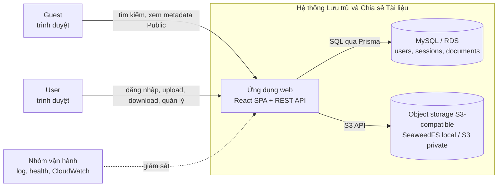

### 6.4 Sơ đồ container

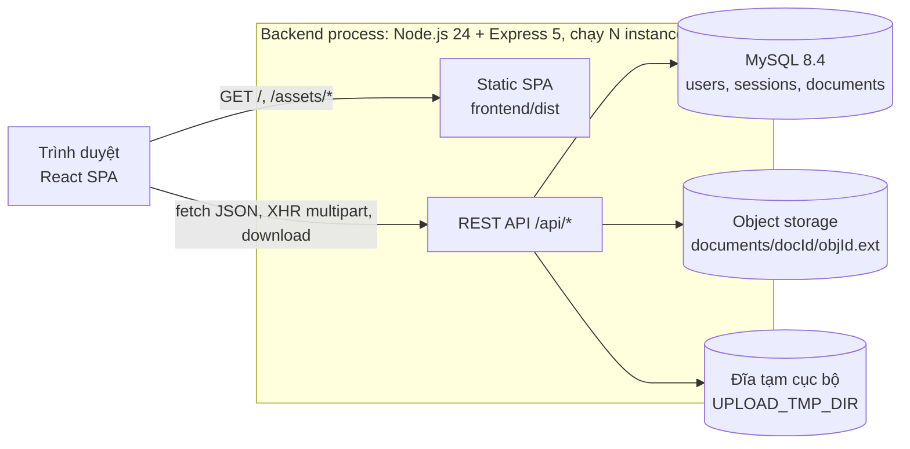

### 6.5 Kiến trúc backend

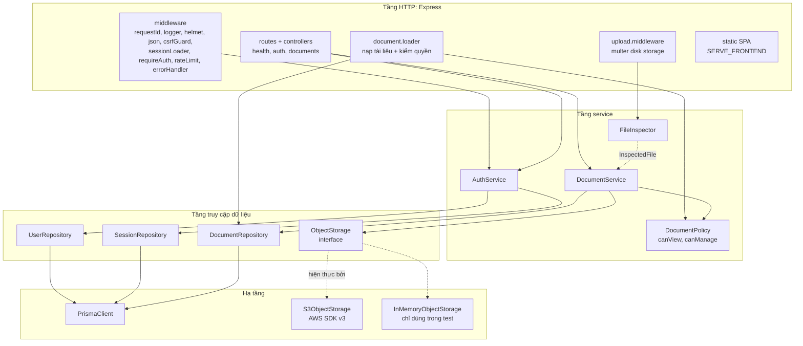

Route/controller xử lý HTTP; service điều phối nghiệp vụ; repository dùng Prisma; ObjectStorage adapter gọi SDK. Các module auth/users, documents/files, health được ghép ở container/app. Chỉ repository truy cập Prisma, chỉ adapter storage gọi AWS SDK.

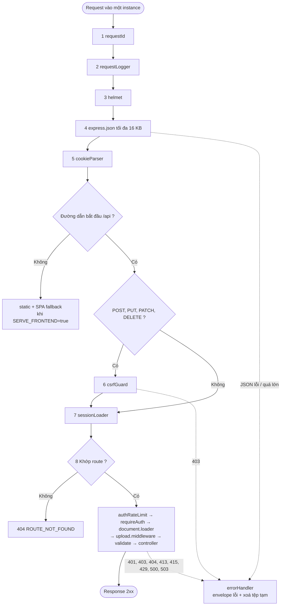

### 6.6 Kiến trúc frontend

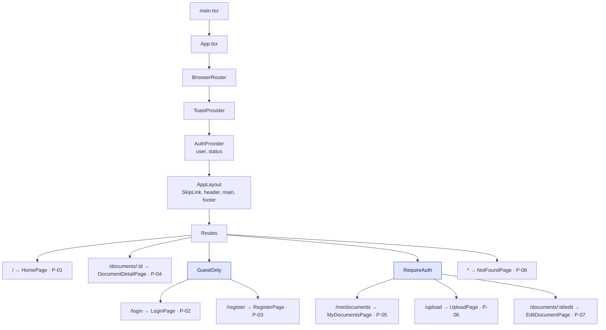

`api/` tập trung fetch/XHR, CSRF và lỗi; `auth/` giữ phiên/guards; `pages/` ghép UI và gọi API/hook; `components/` là UI; `hooks/` giữ logic upload/download/filter/resource; `lib/` chứa validate/format/redirect. Không lưu token vào localStorage.

### 6.7 Cấu trúc repo

```text
/
├── README.md                  runbook ngắn: chạy, kiểm thử, lỗi thường gặp
├── package.json               root không dependency; lint/build/test chạy qua scripts/run-all.mjs
├── run.bat                    Windows: bật MySQL + S3 (Docker hoặc portable), backend :3000, frontend :5173
├── docker-compose.yml         mysql:8.4 + seaweedfs:4.48 (S3 API map ra :9000)
├── docker/                    mysql/init/01-init.sql (tạo DB test, quyền shadow DB), seaweedfs/s3.json
├── scripts/                   run-all.mjs; verify/authz-matrix.mjs, verify/upload-matrix.mjs
├── docs/                      CONTEXT, ARCHITECTURE, MILESTONES, PROJECT_OVERVIEW (file này), PR_M4
├── .github/                   CODEOWNERS, workflows/ci.yml (job ci-required)
├── backend/
│   ├── prisma/                schema.prisma, migrations/ (init + drop_storage_cleanup_tasks)
│   ├── scripts/init-storage.ts   tạo bucket
│   ├── src/                   server.ts, app.ts, container.ts, config/, http/, modules/, storage/, cleanup/, db/, lib/
│   └── test/                  unit/, integration/, helpers/
└── frontend/
    ├── src/                   main.tsx, App.tsx, api/, auth/, components/, pages/, hooks/, lib/, styles/
    ├── e2e/                   Playwright với backend thật (:3000)
    └── ui-tests/              Playwright với API mock (responsive, axe, bàn phím)
```

Bổ sung công cụ development: `backend/dev/` quản lý dịch vụ, `frontend/dev/` là cầu nối Vite, UI nằm ở `frontend/src/admin/` (gitignore từ E1-04, nạp bằng `import.meta.glob` tại `/admin`). Các thư mục này tách khỏi runtime production.

### 6.8 Kiến trúc mở rộng (E1–E8, chưa triển khai)

Ứng dụng public vẫn là một modular monolith; E4–E5 (hồ sơ, bạn bè, `avatars/`, `friendships`) đang hoãn. Admin là tiến trình **riêng, chỉ local**: mã nằm trong thư mục gitignore, không có trong build và không lên AWS. Admin đọc MySQL/SeaweedFS, file số liệu E3 và file log của controller (lỗi E7).

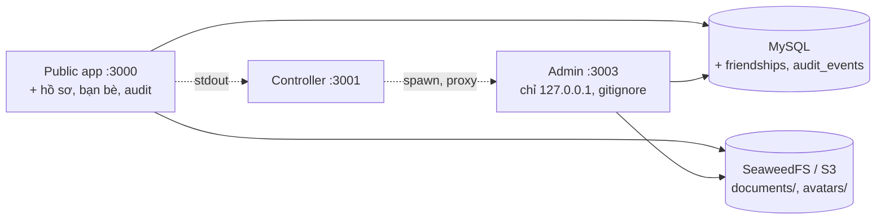

Quyết định, module, API, schema: [ARCHITECTURE §A12](ARCHITECTURE.md#a12-mở-rộng-đề-xuất-e1e8).

## 7. Dữ liệu và lưu trữ

### 7.1 Dữ liệu nằm ở đâu

| Nơi lưu | Nội dung |
|---|---|
| MySQL | Users, sessions, metadata documents; quan hệ owner và quyền |
| SeaweedFS/S3 | Byte của tài liệu; bucket private, key theo document/version |
| UPLOAD_TMP_DIR | Tệp tạm trong lúc nhận/kiểm/upload; được dọn, không là kho chính |

### 7.2 ERD

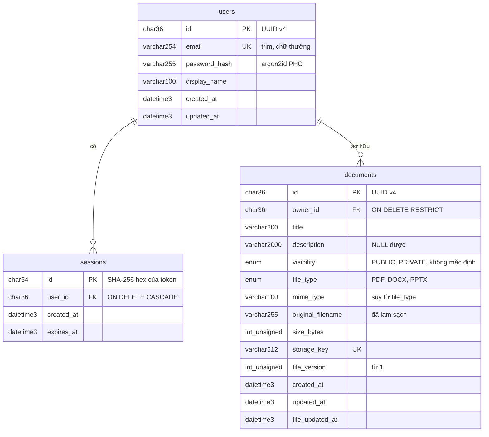

### 7.3 Index, truy vấn chính, bất biến

| Thao tác | Truy vấn | Index |
|---|---|---|
| Nạp phiên | `sessions JOIN users WHERE sessions.id = ?` | PK |
| Đăng nhập | `users WHERE email = ?` | `uq_users_email` |
| Tìm công khai | `WHERE visibility='PUBLIC' [AND (title LIKE ? OR description LIKE ?)] [AND file_type=?] ORDER BY created_at DESC, id DESC LIMIT/OFFSET` + `COUNT(*)` | `idx_documents_visibility_created` |
| Kho cá nhân | `WHERE owner_id=? [AND visibility=?] …` | `idx_documents_owner_created` |
| Dọn phiên lúc khởi động | `DELETE FROM sessions WHERE expires_at < NOW(3) LIMIT 1000` (lặp theo lô) | `idx_sessions_expires_at` |

- **INV-D1:** mọi bản ghi `documents` trỏ tới object đã ghi thành công → không có tài liệu dở dang (BR-06).
- **INV-D2:** `visibility` chỉ đổi qua API-11; API-12 không ghi cột này (BR-07).
- **INV-D3:** `storage_key` dạng `documents/{id}/{uuid}.{ext}`, `ext` khớp `file_type`.

**Migration:** Prisma Migrate, SQL commit trong `backend/prisma/migrations/`, không sửa migration đã áp dụng. `20261020100306_init` tạo schema; `20261023000000_drop_storage_cleanup_tasks` xoá bảng cleanup cũ (CR-007) → còn 3 bảng. Production: `prisma migrate deploy` chạy một lần trước rollout, migration phải tương thích ngược (expand → deploy → contract).

### 7.4 Nguyên tắc object storage

MySQL là nguồn xác định tài liệu tồn tại. Ghi object trước metadata; mỗi lần ghi dùng key `documents/{documentId}/{objectId}.{ext}` mới. Xoá object lỗi ghi `storage.orphan`, chưa có worker thử lại.

Bucket local/test tạo bằng `storage:init`; ghi bằng stream với lib-storage Upload. Mục tiêu S3: Block Public Access, BucketOwnerEnforced, SSE-S3, tắt versioning và huỷ multipart dở sau một ngày. Mọi lượt tải đi qua backend sau kiểm quyền.

### 7.5 Vòng đời tài liệu

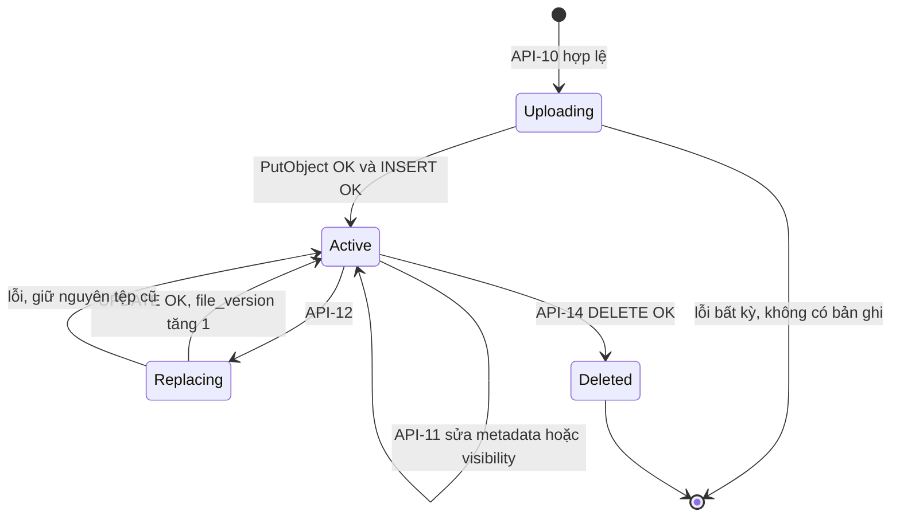

Chỉ INSERT metadata thành công mới có tài liệu trong danh sách. Thay tệp UPDATE key/fileVersion, giữ metadata/chế độ; xoá metadata làm mọi endpoint coi tài liệu không còn. Ma trận lỗi ở §10.5.

## 8. Xác thực, phân quyền, bảo mật

### 8.1 Phiên và mật khẩu

| Chủ đề | Thiết kế |
|---|---|
| Mật khẩu | Argon2id: memoryCost 19456 KiB, timeCost 2, parallelism 1; đăng ký 8–128 ký tự, không trim |
| Token/DB | randomBytes(32) base64url; DB giữ SHA-256, không giữ token rõ |
| Thời hạn | Mặc định 168 giờ, cố định; không gia hạn trượt |
| Đăng nhập/đăng xuất | Tạo phiên mới và thu hồi phiên cũ; logout xoá cookie/DB, luôn 204 |
| Cookie | HttpOnly, SameSite=Lax, Path=/, không Domain; Secure khi bật HTTPS |

sessionLoader bỏ cookie lạ/hết hạn, xoá phiên hết hạn; hợp lệ thì nạp req.auth. Email không tồn tại vẫn verify hash giả để giảm khác biệt thời gian.

### 8.2 Chống CSRF

POST/PUT/PATCH/DELETE của API cần `X-CSRF-Protection: 1`; nếu có Origin thì phải thuộc ALLOWED_ORIGINS. Thiếu/sai trả 403. SameSite=Lax là lớp thêm; GET không cần header.

### 8.3 Phân quyền tài liệu


Query Public lọc visibility ngay trong SQL; kho cá nhân lọc owner_id. Không lọc quyền sau khi đã trả dữ liệu. Private của người khác trả 404, quản lý Public trái phép trả 403.

### 8.4 Các lớp bảo vệ khác

Rate limit đăng nhập/đăng ký theo IP và instance; upload giới hạn byte, kiểm nội dung và làm sạch tên. Download dùng attachment/nosniff; helmet/CSP ngăn nhúng và script ngoài; redirect chỉ nhận path nội bộ an toàn. Trên AWS dùng IAM Role/IMDSv2, private subnet/SG và phương án TLS đã chốt; log che mật khẩu/cookie/token.

### 8.5 Đăng nhập developer local

Tài khoản local tách khỏi users trong MySQL. Chạy `npm --prefix backend run dev:account -- ten_cua_ban` từ gốc repo để nhận mật khẩu ngẫu nhiên; file `backend/tmp/developer-account.json` chỉ giữ hash scrypt và không theo Git.

Controller kiểm phiên cho toàn bộ công cụ/log; cookie HttpOnly/SameSite=Strict, tối đa 8 giờ, đổi tài khoản/đăng xuất thu hồi phiên. Đăng nhập này hoạt động khi Express/MySQL tắt. CLI dùng capability trên máy để khôi phục dịch vụ; UI/endpoint điều khiển không đưa vào production.

## 9. Đặc tả REST API

Contract đầy đủ với input/output, lỗi, thao tác DB/storage và ví dụ request/response ở [ARCHITECTURE §A7](ARCHITECTURE.md#a7-rest-api-contract).

### 9.1 Quy ước chung

Base /api, JSON UTF-8/camelCase, enum HOA, ISO UTC. Response thành công `{data: ...}`; 204 không body, download trả byte. Request ghi cần CSRF header; body lạ bị từ chối, query lạ bỏ qua. JSON ≤16 KiB; multipart một file ≤50 MiB, tối đa năm part văn bản, mỗi part ≤16 KiB.

```json
{
  "error": {
    "code": "VALIDATION_ERROR",
    "message": "Dữ liệu gửi lên không hợp lệ.",
    "details": [ { "field": "title", "issue": "TOO_LONG", "message": "Tiêu đề tối đa 200 ký tự." } ],
    "requestId": "0b7f5d0e-2c55-4a7e-8f61-3e0f3f1a9b2c"
  }
}
```

FE rẽ nhánh theo code; details luôn là mảng; requestId trùng X-Request-Id, dùng để tra log. PATCH bỏ qua trường không gửi, description null/chuỗi rỗng xoá mô tả.

### 9.2 Endpoint

| ID | Method | Path | Quyền | CSRF | Thành công | Lỗi đặc thù |
|---|---|---|---|---|---|---|
| API-01 | GET | `/api/health` | Công khai | — | 200 `{status, instanceId, version, uptimeSeconds}` | — (không chạm DB/storage) |
| API-02 | GET | `/api/health/ready` | Công khai | — | 200 `{status, instanceId, checks}` | 503 `SERVICE_UNAVAILABLE` |
| API-03 | GET | `/api/auth/me` | Cookie tuỳ chọn | — | 200 `{user: UserDto \| null}` | không bao giờ 401 |
| API-04 | POST | `/api/auth/register` | Công khai | có | 201 `{user}` + `Set-Cookie` | 400, 409 `EMAIL_ALREADY_EXISTS`, 429 |
| API-05 | POST | `/api/auth/login` | Công khai | có | 200 `{user}` + `Set-Cookie` | 400, 401 `INVALID_CREDENTIALS`, 429 |
| API-06 | POST | `/api/auth/logout` | Cookie tuỳ chọn | có | 204 + xoá cookie | — (idempotent) |
| API-07 | GET | `/api/documents` | Công khai | — | 200 `Page<DocumentDto>` chỉ Public | 400 |
| API-08 | GET | `/api/documents/mine` | User | — | 200 `Page<DocumentDto>` của mình | 401, 400 |
| API-09 | GET | `/api/documents/{id}` | `canView` | — | 200 `DocumentDto` | 404 |
| API-10 | POST | `/api/documents` | User | có | 201 `DocumentDto` + `Location` | 401, 400, 413, 415, 503 |
| API-11 | PATCH | `/api/documents/{id}` | `canManage` | có | 200 `DocumentDto` | 401, 403, 404, 400 (`NO_CHANGES` khi `{}`) |
| API-12 | PUT | `/api/documents/{id}/file` | `canManage` (trước khi đọc body) | có | 200 `DocumentDto`, `fileVersion` + 1 | 401, 403, 404, 400, 413, 415, 503 |
| API-13 | GET | `/api/documents/{id}/download` | User + `canView` | — | 200 nhị phân, `attachment` | 401, 404, 503 trước khi stream |
| API-14 | DELETE | `/api/documents/{id}` | `canManage` | có | 204 (kể cả khi xoá object lỗi) | 401, 403, 404 |

Lỗi chung không lặp lại ở bảng: 500 `INTERNAL_ERROR`; request ghi thêm 403 `CSRF_REJECTED`; body JSON thêm 400 `INVALID_JSON`, 413 `PAYLOAD_TOO_LARGE`. `/api/documents/mine` được đăng ký trước `/api/documents/:id`.

### 9.3 Mã lỗi

| HTTP | Code và tình huống |
|---|---|
| 400 | VALIDATION_ERROR (details theo trường), INVALID_JSON |
| 401/403 | UNAUTHENTICATED, INVALID_CREDENTIALS / CSRF_REJECTED, FORBIDDEN |
| 404/409 | ROUTE_NOT_FOUND, DOCUMENT_NOT_FOUND / EMAIL_ALREADY_EXISTS |
| 413/415 | PAYLOAD_TOO_LARGE, FILE_TOO_LARGE / UNSUPPORTED_FILE_TYPE |
| 429 | RATE_LIMITED, kèm Retry-After |
| 500/503 | INTERNAL_ERROR / STORAGE_UNAVAILABLE, SERVICE_UNAVAILABLE |

Client còn có NETWORK_ERROR và ABORTED. Lỗi giữa lúc stream chỉ có thể ngắt kết nối, không gửi JSON mới.

### 9.4 Schema và validate

DocumentDto có id/title/description/visibility/fileType/originalFilename/sizeBytes/fileVersion/owner/isOwner và ba timestamps. OwnerDto chỉ có id/displayName; UserDto của chính người gọi thêm email/createdAt. Page có items/page/pageSize/totalItems/totalPages.

| Trường | Giới hạn |
|---|---|
| Email/password | Email trim + chữ thường, ≤254; mật khẩu không trim: đăng ký 8–128, login 1–128 |
| DisplayName/title/description | 1–100 / 1–200 / 0–2000 ký tự; title không xuống dòng, description cho phép xuống dòng |
| File/visibility | Một PDF/DOCX/PPTX thật, 1–52.428.800 byte; Public/Private bắt buộc chọn |
| Query | q ≤100; fileType PDF/DOCX/PPTX; sort newest/title; page 1–10000, pageSize 1–50, mặc định 12 |

Độ dài tính theo Unicode code point. LIKE escape ký tự đặc biệt; các giá trị %, _ được tìm theo nghĩa đen. Schema field-by-field ở §A7.4–A7.6.

## 10. Luồng xử lý chính

### 10.1 Đăng ký / đăng nhập / đăng xuất

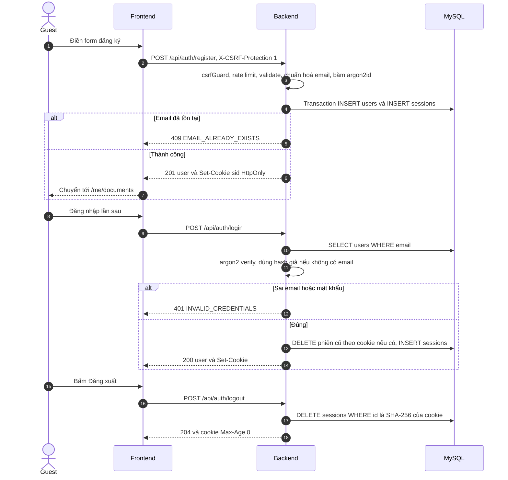

Các thao tác auth xoay/thu hồi phiên ở MySQL, nên cookie không phụ thuộc instance tiếp nhận request.

### 10.2 Tải lên (API-10), gồm luồng lỗi

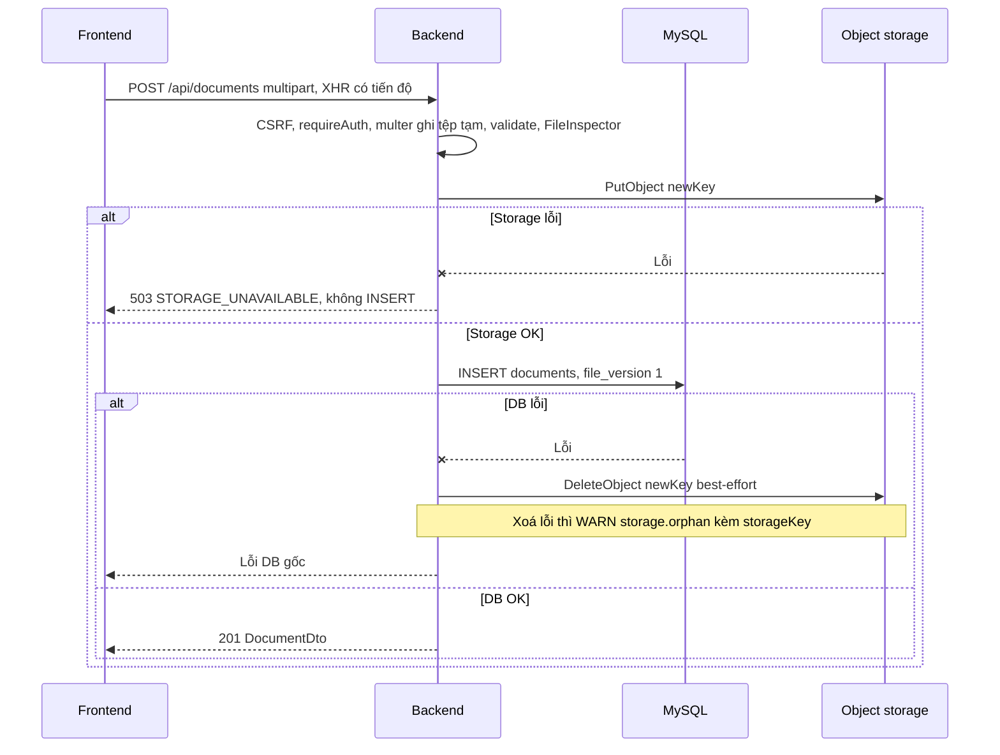

Tệp tạm luôn được dọn trong finally; DB lỗi sau PutObject thì thử xoá object mới, không có transaction chung giữa hai nơi.

### 10.3 Tải xuống (API-13)

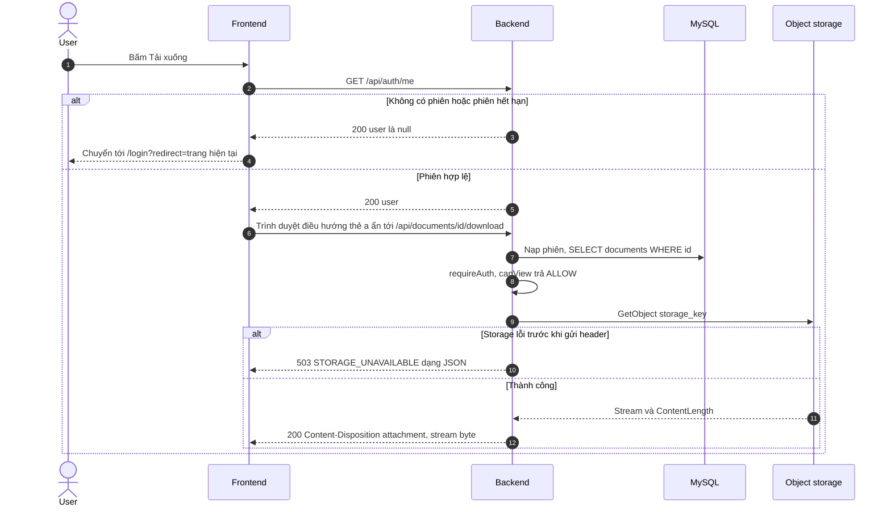

FE kiểm phiên rồi điều hướng link tải. Nếu phiên mất giữa hai request, trình duyệt có thể hiện JSON lỗi; đây là hạn chế đã biết.

### 10.4 Thay thế tệp (API-12) và xoá (API-14)

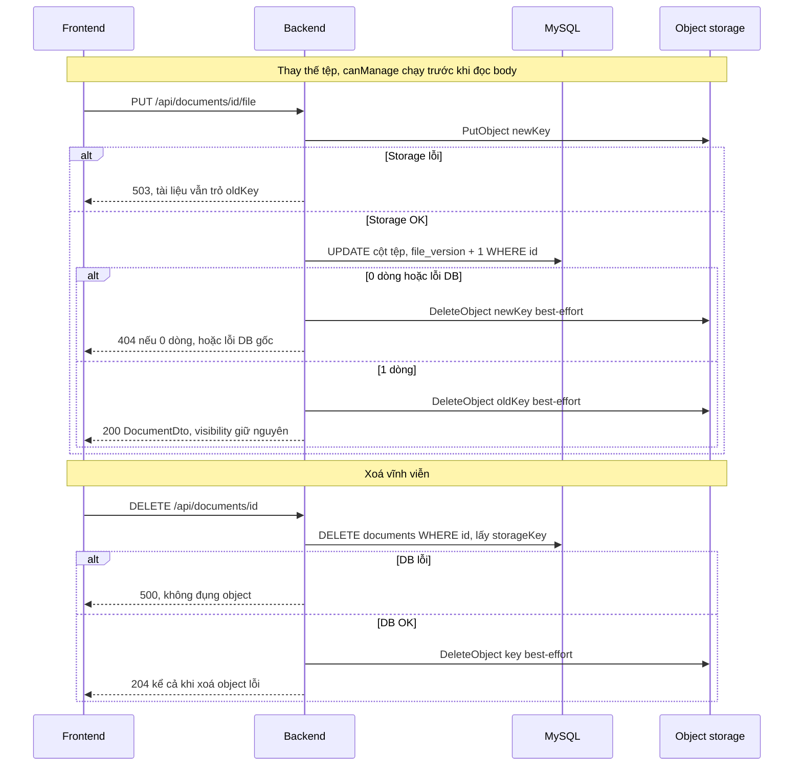

### 10.5 Ma trận lỗi DB ↔ storage

| Điểm lỗi | `documents` | Object | HTTP / phục hồi |
|---|---|---|---|
| Upload PutObject lỗi | Không có | Có thể có phần dư | 503 |
| Upload INSERT lỗi | Không có | Thử xoá key mới | Lỗi DB gốc; xoá lỗi → `storage.orphan` |
| Crash sau PutObject | Không có | Có thể mồ côi | Xử lý thủ công |
| Replace PutObject lỗi | Trỏ key cũ | Tệp cũ nguyên vẹn | 503 |
| Replace UPDATE 0 dòng / lỗi | Không đổi | Thử xoá key mới | 404 / lỗi DB gốc |
| Replace xoá key cũ lỗi | Trỏ key mới | Key cũ mồ côi | 200 + `storage.orphan` |
| Delete DB lỗi | Còn nguyên | Còn nguyên | 500 |
| Delete object lỗi | Đã xoá | Key mồ côi | 204 + `storage.orphan` |
| Download object mất | Có | Không có | 503 + ERROR `download.object_missing` |

**Hạn chế được chấp nhận (CR-007):** object mồ côi có thể còn lại sau lỗi/crash, tra cứu qua log `storage.orphan`; không có cơ chế tự thu gom, không lịch sử phiên bản.

### 10.6 Kiểm tra nội dung tệp (FileInspector)

| # | Quy tắc | Lỗi |
|---|---|---|
| 1 | `sizeBytes == 0` | 400 `EMPTY_FILE` |
| 2 | Đuôi (chữ thường, sau khi làm sạch tên) ∈ {`pdf`, `docx`, `pptx`} | 415 |
| 3 | PDF: 5 byte đầu là `%PDF-` | 415 |
| 4 | DOCX/PPTX: 4 byte đầu `PK\x03\x04`; đọc central directory bằng yauzl (không giải nén, ≤ 10 000 entry); phải có `[Content_Types].xml` **và** `word/document.xml` (DOCX) / `ppt/presentation.xml` (PPTX) | 415 |
| 5 | `mimeType` suy từ `fileType`, **bỏ qua** `Content-Type` client gửi | — |
| 6 | Làm sạch tên: giải mã UTF-8 → basename → bỏ ký tự điều khiển và `"` → NFC → trim → cắt còn ≤ 255 (giữ đuôi) → rỗng thì `tai-lieu.<ext>` | — |

## 11. Frontend

### 11.1 Trang và điều hướng

| Page | Route | Guard | Nội dung | API |
|---|---|---|---|---|
| P-01 Khám phá | `/` | — | SearchBar (`q`, `fileType`, `sort`), lưới thẻ tài liệu Public, phân trang; trạng thái URL | API-07, tải xuống API-03 + 13 |
| P-02 Đăng nhập | `/login` | GuestOnly | Email, mật khẩu; quay lại `redirect` an toàn | API-05 |
| P-03 Đăng ký | `/register` | GuestOnly | Tên hiển thị, email, mật khẩu, xác nhận mật khẩu | API-04 |
| P-04 Chi tiết | `/documents/:id` | — | Metadata; nút theo vai trò (tải xuống / đăng nhập để tải / sửa, xoá nếu owner) | API-09, 13, 14 |
| P-05 Tài liệu của tôi | `/me/documents` | RequireAuth | Bảng (≥ 640 px) hoặc thẻ; lọc chế độ/loại; tải, sửa, xoá | API-08, 13, 14 |
| P-06 Tải lên | `/upload` | RequireAuth | Dropzone, tiêu đề tự điền từ tên tệp, mô tả, chọn chế độ (không chọn sẵn), thanh tiến độ, huỷ | API-10 |
| P-07 Chỉnh sửa | `/documents/:id/edit` | RequireAuth | Sửa thông tin; Private → Public cần xác nhận; thay tệp; xoá | API-09, 11, 12, 14 |
| P-08 Không tìm thấy | `*` | — | Trang 404 | — |

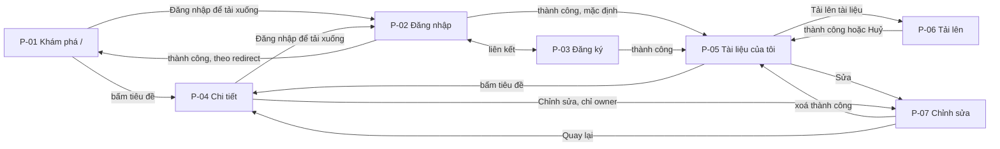

### 11.2 Trạng thái theo xác thực

AuthProvider nạp API-03, giữ user/status trong bộ nhớ. RequireAuth chuyển Guest về login kèm redirect; GuestOnly chuyển User về kho mình. Hết phiên bỏ auth state và thông báo. Lỗi backend giữ bản nháp/tệp/cache đúng tài khoản/tài liệu, khoá thao tác cần server và không tự gửi lại mutation.

### 11.3 Nguyên tắc UI

Giao diện tiếng Việt, nền sáng với màu nâu taupe, trắng kem và xanh sage; token ở styles/tokens.css. Form có validate/lỗi theo trường, upload có tiến độ/huỷ; xoá/thay tệp/Private → Public dùng dialog xác nhận. Có skip link, nhãn, live region, bàn phím và kiểm responsive từ 360 px; chi tiết từng trang/component ở ARCHITECTURE §A8.

## 12. Môi trường local và cấu hình

### 12.1 Chạy nhanh

Làm theo [README](../README.md) để chạy Windows hoặc Docker. Lần đầu tạo tài khoản developer, sau đó mở Start.vbs hoặc `.\run.bat start`; tài khoản dùng website tạo riêng ở /register. Production-like build BE/FE, đặt SERVE_FRONTEND=true cho process rồi chạy backend start.


Cổng 3001 dành cho controller local, nên dùng 3002 cho backend thứ hai. Thử request ghi qua hai backend cần cấu hình ALLOWED_ORIGINS gồm cả origin 3000 và 3002; ca M4-08 vẫn chưa nghiệm thu.

### 12.2 Biến môi trường backend

Mẫu dev ở [backend/.env.example](../backend/.env.example); bảng đầy đủ local/test/AWS ở [ARCHITECTURE §A10.2](ARCHITECTURE.md#a102-biến-môi-trường-backend). `.env` không commit, frontend không cần file env riêng.

| Nhóm | Cấu hình cần chú ý |
|---|---|
| DB/storage | DATABASE_URL, S3_BUCKET/REGION; local có S3_ENDPOINT và path-style=true; AWS bỏ endpoint/key dev, dùng IAM Role |
| Cookie/origin | ALLOWED_ORIGINS, SESSION_COOKIE_NAME/TTL, COOKIE_SECURE, HSTS_ENABLED, TRUST_PROXY phải khớp HTTP/HTTPS/ALB |
| Runtime | NODE_ENV/PORT/INSTANCE_ID, UPLOAD_TMP_DIR, SERVE_FRONTEND/FRONTEND_DIST_DIR, LOG_LEVEL, AUTH_RATE_LIMIT_MAX |

### 12.3 Khởi động và tắt

Server load config → chuẩn bị thư mục tạm và DB/storage → dọn tạm/phiên hết hạn → listen. Liveness không phụ thuộc DB/storage. Upload timeout 900s; keepAlive/headers 125/126s. SIGTERM/SIGINT ngừng nhận request, đợi tối đa 30s rồi disconnect DB/storage. Trên Windows dừng backend trước build/generate Prisma để tránh khoá DLL.

## 13. Kiến trúc AWS mục tiêu (M5, chưa triển khai)

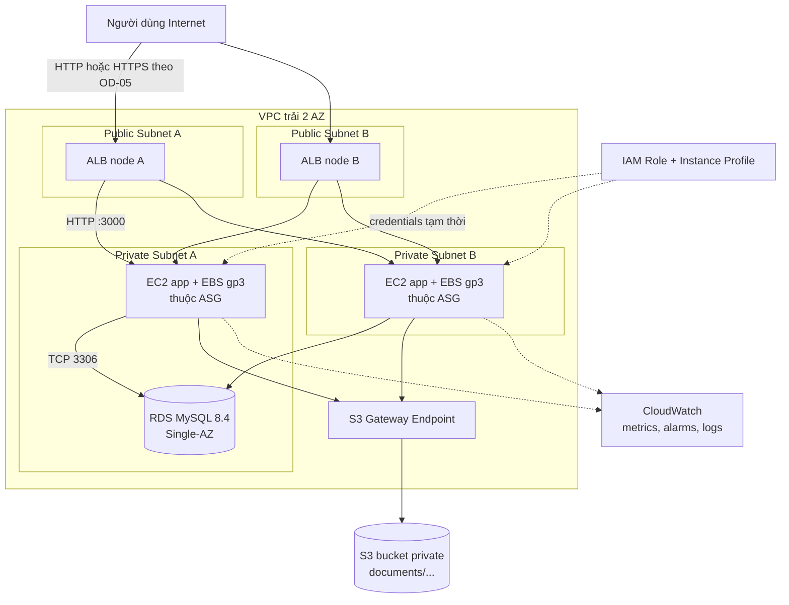

### 13.1 Ánh xạ local → AWS

| Local | AWS | Thay đổi cấu hình |
|---|---|---|
| MySQL 8.4 (container/portable) | RDS MySQL 8.4 `db.t3.micro` Single-AZ, không public, subnet group 2 private subnet | `DATABASE_URL`, TLS |
| SeaweedFS bucket | S3 bucket private + S3 Gateway Endpoint | `S3_ENDPOINT` trống, tắt path-style, bỏ access key → IAM Role |
| Backend `:3000` (và `:3001`) | EC2 `t3.micro` trong ASG min 2 / desired 2 / max 4 trên 2 private subnet, cùng artifact | `SERVE_FRONTEND=true`, `TRUST_PROXY=1` |
| Vite proxy `:5173` | ALB internet-facing → target group HTTP:3000, health check `/api/health` | SPA do backend phục vụ |
| `backend/tmp/uploads` | EBS gp3 20 GiB mã hoá | `UPLOAD_TMP_DIR` |
| Log console | CloudWatch Logs (nếu OD-06 cho phép) + metric có sẵn | CloudWatch Agent |
| `backend/.env` | Launch template user data / SSM Parameter Store (OD-07) | — |

### 13.2 Mạng, quyền, giám sát

ALB ở hai public subnet; EC2/ASG ở hai private subnet; RDS private Single-AZ; S3 dùng Gateway Endpoint. EC2 chỉ nhận traffic ứng dụng từ SG của ALB, RDS chỉ nhận từ SG ứng dụng.

EC2 dùng IAM Role/instance profile, quyền S3 giới hạn bucket/prefix và không nhúng access key. ASG dự kiến hai instance ban đầu, tối đa bốn; metric/health/grace/timeouts phải thử trước. CloudWatch có alarm được kích hoạt thực tế và lưu bằng chứng. Cấu hình/policy chi tiết: ARCHITECTURE §A10.9.

### 13.3 Ánh xạ 8 hạng mục bắt buộc của đề bài

| # | Hạng mục | Thành phần |
|---|---|---|
| 1 | Mạng riêng, subnet public/private trên ≥ 2 AZ | VPC, 2 public + 2 private subnet |
| 2 | Máy chủ ứng dụng trong private subnet | EC2 trong ASG ở private subnet, chỉ ALB vào được |
| 3 | ≥ 2 loại lưu trữ | S3 (object) + EBS (block) + RDS |
| 4 | Một cơ sở dữ liệu | RDS MySQL 8.4 |
| 5 | IAM Role, không nhúng access key | Instance profile + IMDSv2; repo không có access key |
| 6 | Cân bằng tải + tự mở rộng, demo khi tải tăng | ALB + ASG 2–4; kịch bản thử tải M5-08 |
| 7 | Giám sát, ≥ 1 alarm kích hoạt thử | CloudWatch alarm `UnHealthyHostCount` |
| 8 | Dự toán chi phí tháng | M5-09 (Pricing Calculator) |

### 13.4 Vấn đề AWS còn mở

| ID | Vấn đề | Phương án |
|---|---|---|
| U-01 | Egress cho EC2 private (cài runtime, gửi log, Session Manager) | Chỉ S3 Gateway Endpoint / thêm Interface Endpoint / NAT Gateway (có phí, chưa có trong dự toán gốc) |
| U-02 | HTTPS | Tên miền + ACM, hoặc chỉ HTTP và ghi nhận rủi ro cookie không mã hoá |
| U-03 | Mật khẩu RDS | SSM SecureString (cần endpoint/NAT) hoặc user data |
| U-04 | Sẵn sàng | RDS Single-AZ là điểm lỗi đơn — đã chấp nhận vì chi phí |
| U-05 | Metric scaling | CPU khó tăng vì app chủ yếu chờ I/O; cân nhắc `ALBRequestCountPerTarget` |
| U-06…U-08 | IPv4 công khai của ALB, burst credit t3, quota tài khoản | Rà soát ở M5-09 |

## 14. Kiểm thử, CI và tiến độ

### 14.1 Bộ kiểm thử

| Loại | Lệnh | Bằng chứng đã ghi nhận |
|---|---|---|
| Backend/Frontend unit | `npm test` tại root | 67 backend + 80 frontend ở lượt bàn giao local |
| Launcher/controller | `node --test backend/dev/*.test.mjs` | 27 ca |
| Backend integration | `npm --prefix backend run test:integration` | M4: 74 ca, MySQL/storage; chỉ reset btl_cloud_test |
| E2E thật | `npm --prefix frontend run test:e2e` | M4: 9 ca với production-like :3000 |
| UI mock | `npm --prefix frontend run test:ui` | M4: 7 ca responsive/axe/bàn phím |
| Trình duyệt local | Playwright local config; tài khoản qua BTL_TEST_DEVELOPER_USERNAME/PASSWORD | Lượt bàn giao: 5 ca auth/control/readiness |
| Ma trận | `scripts/verify/authz-matrix.mjs`, `upload-matrix.mjs` | M4: 82 kiểm tra quyền, 42 kiểm tra upload/download |

Đây là các lượt kiểm chứng đã ghi nhận, không phải tuyên bố chạy lại toàn bộ sau mỗi lần sửa tài liệu. CI ci-required chạy npm ci → lint → build → unit; integration/E2E riêng. PR vào main cần CI và code owner review.

### 14.2 Truy vết yêu cầu → kiểm chứng

Bảng đầy đủ FR → UC → API → Page → AC → task ở [ARCHITECTURE §A11.1](ARCHITECTURE.md#a111-truy-vết-fr--uc--api--page--ac--task). Kết quả theo FR và lệnh kiểm chứng ở MILESTONES M4.

### 14.3 Tiến độ và việc còn mở

M4-12/M4-G chờ owner; M4-07 lỗi storage thật và M4-08 nhiều instance hoãn. M5-01…10/M5-G chưa làm. SEC-002 Prisma CLI/deepmerge-ts là advisory đã ghi nhận, cần xử lý riêng. E1–E3, E6–E8 đã duyệt (CR-009), task NOT STARTED; E4–E5 hoãn ([MILESTONES › E1–E8](MILESTONES.md#e1e8--mở-rộng-đề-xuất)).

Giới hạn: object mồ côi sau lỗi/crash, replace last-write-wins, rate limit theo instance, race hết phiên lúc tải và collation đ/d cần kiểm chứng. Hạn nộp theo PDF: 09/11/2026 báo cáo/mã nguồn/video; 16/11/2026 bảo vệ. Chi tiết trạng thái/nghiệm thu ở MILESTONES.

## 15. Đồng bộ tài liệu gốc với mã nguồn

Các quyết định đang dùng: SeaweedFS thay MinIO (CR-001), launcher Windows (CR-004), hoãn hai ca M4 (CR-005), best-effort và last-write-wins, bỏ worker/guard (CR-007). Giao diện dùng bảng màu nâu–kem–sage nền sáng; lịch sử bảng màu sáng/tối (CR-006) và các thay đổi khác được giữ ở MILESTONES/Git.

Bản cập nhật này giữ các sơ đồ, hợp đồng API chi tiết, schema và tiêu chí chấp nhận; phần tổng quan dẫn tới nơi tra cứu thay vì sao chép mọi bảng.

## Thuật ngữ

| Thuật ngữ | Nghĩa |
|---|---|
| Guest / User / Owner | Chưa đăng nhập / đã đăng nhập / User đã tải lên tài liệu đang xét |
| Metadata | Tiêu đề, mô tả, chế độ, tên tệp, kích thước, loại… (MySQL) |
| Object | Byte của tệp trong object storage |
| Liveness / Readiness | `/api/health` (process còn sống) / `/api/health/ready` (DB + storage sẵn sàng) |
| Object mồ côi | Object không còn bản ghi `documents` nào trỏ tới, do lỗi giữa DB và storage |
| ID tham chiếu | `FR`, `BR`, `AC`, `NFR`, `OD`, `RK`: CONTEXT · `D`, `UC`, `API`, `P`, `SEQ`, `INV`, `U`: ARCHITECTURE · `M<n>-xx`, `CR`, `ACC`: MILESTONES |
