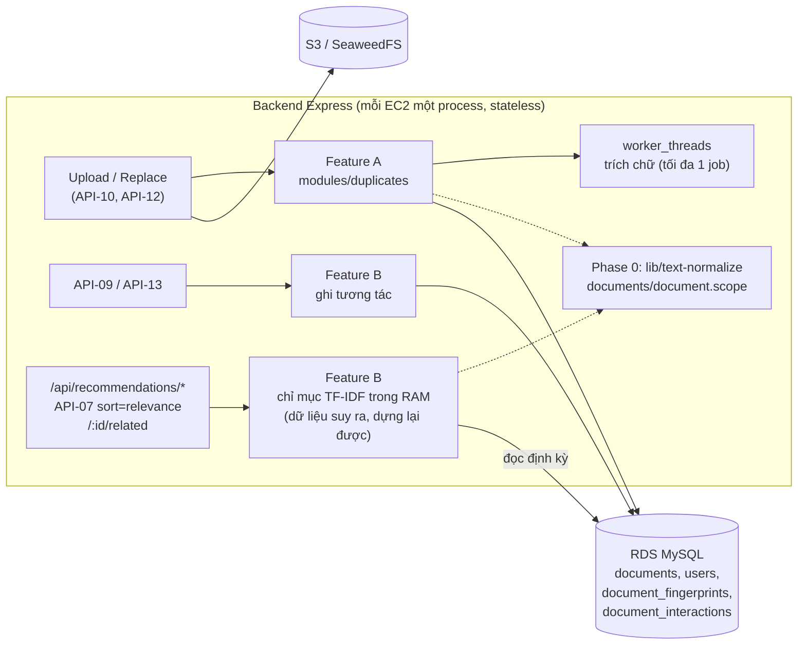
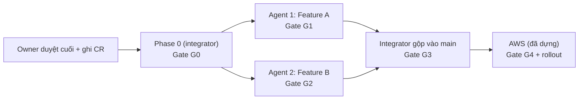

# SHARED_CONTRACTS — Nền chung cho Duplicate Detection và Hybrid Recommendation

> **Trạng thái: ĐÃ DUYỆT CÓ ĐIỀU KIỆN (16/11/2026), đã sửa theo yêu cầu owner, chờ duyệt cuối. Chưa triển khai.** Bộ tài liệu gồm 4 file đặc tả + 2 prompt agent:
> [DUPLICATE_DETECTION_SPEC](DUPLICATE_DETECTION_SPEC.md) (Feature A), [HYBRID_RECOMMENDATION_SPEC](HYBRID_RECOMMENDATION_SPEC.md) (Feature B), file này, [ACCEPTANCE_AND_ROLLOUT](ACCEPTANCE_AND_ROLLOUT.md), [AGENT_1_IMPLEMENTATION_PROMPT](AGENT_1_IMPLEMENTATION_PROMPT.md), [AGENT_2_IMPLEMENTATION_PROMPT](AGENT_2_IMPLEMENTATION_PROMPT.md).
>
> Ký hiệu: **[Đã kiểm]** là sự thật đọc từ repo · **[Owner xác nhận]** là thông tin owner cung cấp, repo chưa ghi lại · **[Bàn giao AWS]** là tài liệu `AWS_Architecture_BTL_Cloud_Full_2026-11-15.md` (ngoài repo) · **[CẦN KIỂM TRA]** là điểm nguồn mâu thuẫn hoặc chưa có bằng chứng · **[Đo local]** là số đo trên máy dev Windows với Node 24.19, **không phải** t3.micro · **[Giả định]** là điều chưa kiểm chứng · **[Cần đo]** là con số phải benchmark trước khi chốt.

## 1. Mục tiêu và phạm vi

File này chốt mọi thứ mà hai agent **cùng dùng**, gồm schema, migration, tiện ích xử lý chữ, điều kiện quyền riêng tư, cấu hình, mã lỗi, quyền sở hữu file, quy trình branch/merge, và sổ quyết định và rủi ro. Mục tiêu là để hai agent làm song song mà không phải tự thiết kế lại hay đưa ra quyết định xung khắc nhau.

Hai feature đều chạy **bên trong backend Express hiện có**. Không thêm service, hàng đợi hay hạ tầng AWS mới (C-01).

## 2. Hiện trạng đã kiểm (baseline)

**Baseline code:** `origin/main` @ `2f1ebbd` (kiểm ngày 15/11/2026). `TAV_branch` chỉ hơn `main` một commit docs (`cfd315f`), code giống hệt.

### 2.1 Module và trách nhiệm [Đã kiểm]

| Đường dẫn | Trách nhiệm | Liên quan |
|---|---|---|
| `backend/src/app.ts` | Pipeline Express, gắn router `/api/auth`, `/api/documents`, `/api/health` | B thêm router |
| `backend/src/container.ts` | Lắp repository/service, có `createTransactionRunner` | A, B |
| `backend/src/server.ts` | Khởi động: dọn tmp → xoá phiên hết hạn → xoá audit quá hạn → listen | B (purge, index) |
| `backend/src/config/env.ts` | Đọc env bằng zod, sai thì dừng khi khởi động | Phase 0 |
| `backend/src/http/errors.ts` | `ErrorCode`, HTTP status, message tiếng Việt, `AppError` | A |
| `backend/src/http/middleware/request-context.ts` | pino-http, log `req.url` **gồm cả query string** | B (che `q`) |
| `backend/src/lib/module-of.ts` | Ánh xạ tiền tố đường dẫn → `module` trong log | B |
| `backend/src/modules/documents/document.repository.ts` | `search()` (COUNT + trang id bằng SQL thô, LIKE có ESCAPE), `insert`, `updateFile` (`file_version + 1`), `delete` | A, B |
| `backend/src/modules/documents/documents.service.ts` | `create` (PutObject → INSERT, bù trừ object), `replaceFile`, `delete`, `searchPublic` | A, B |
| `backend/src/modules/documents/documents.controller.ts` / `documents.routes.ts` | API-07…14; loader `view`/`manage` áp policy trước khi đọc body | A, B |
| `backend/src/modules/documents/document.policy.ts` | `canView`, `canManage` (hàm thuần) | Không đổi |
| `backend/src/modules/documents/document.loader.ts` | Nạp tài liệu; owner đang DELETING → 404 | Không đổi |
| `backend/src/modules/files/file-inspector.ts` | Kiểm magic bytes; DOCX/PPTX đọc central directory bằng `yauzl` (≤ 10 000 entry, không giải nén) | A |
| `backend/src/modules/files/upload.middleware.ts` | multer ghi 1 tệp ≤ 52 428 800 byte ra `UPLOAD_TMP_DIR` | Không đổi |
| `backend/src/modules/audit/*` | `audited(action)` ghi `audit_events` khi response đóng; **không** ghi xem trang, tìm kiếm, xem chi tiết | Không đổi |
| `backend/src/modules/users/activity-tracker.ts` | Ghi `last_active_at` tối đa 1 lần / 5 phút / user / process | Mẫu tham khảo |
| `backend/admin/deletion.ts` (gitignore, chỉ máy owner) | Xoá tài khoản: đặt DELETING → xoá phiên → xoá từng tài liệu (object rồi row) → xoá audit của user → xoá user | Dựa vào FK CASCADE |
| `frontend/src/pages/DocumentListPages.tsx` | `HomePage` = danh sách Public + tìm kiếm | B |
| `frontend/src/pages/DocumentDetailPage.tsx`, `UploadPage.tsx`, `EditDocumentPage.tsx` | Chi tiết, upload, sửa/thay tệp | A, B |
| `frontend/src/api/*.ts` | `documentsApi`, `uploadMultipart` (XHR), `ApiError` | A, B |
| `backend/test/integration/*`, `backend/test/helpers/contract.ts` | Supertest trên MySQL + SeaweedFS thật; schema hợp đồng `.strict()` | A, B |

### 2.2 Sự thật quan trọng cho thiết kế [Đã kiểm]

- **Phạm vi hiện tại loại trừ "gợi ý" và "tìm kiếm toàn văn"** ([PROJECT_OVERVIEW §2](../PROJECT_OVERVIEW.md)). Cả hai feature cần một **CR mới** được duyệt (DR-01).
- Collation của bảng là `utf8mb4_0900_ai_ci`: không phân biệt hoa/thường và dấu. Bảng mới phải dùng cùng collation. Migration trên nhánh thử nghiệm dùng `utf8mb4_unicode_ci`, không khớp.
- `documents` **không có** cột băm nội dung. Không nơi nào ghi lượt xem; audit ghi `DOCUMENT_DOWNLOAD` nhưng giữ 90 ngày và bị xoá khi xoá tài khoản.
- API-09 (`GET /api/documents/:id`) cho cả Guest; API-13 (tải xuống) bắt buộc đăng nhập.
- **Xoá tài khoản chỉ có trong admin local** (gitignore), không có trên bản build/AWS ([ARCHITECTURE §A12.8](../ARCHITECTURE.md#a128-tương-thích-aws-và-rủi-ro)). Trong app public, user DELETING bị coi như không tồn tại.
- Rate limit dùng `express-rate-limit` lưu trong bộ nhớ, tính riêng từng instance.
- Test hiện có **upload cùng một tệp nhiều lần** (`pdfBuffer()` mặc định trong `backend/test/integration/context.ts`). Nếu mặc định `block` thì test cũ sẽ vỡ.
- `contract.ts` dùng `documentDtoSchema.strict()` cho response API-10/12. `database-schema.test.ts` khẳng định có đúng **4** bảng. Phải cập nhật cả hai.
- Launcher local tự chạy `prisma migrate deploy` mỗi lần khởi động (`backend/dev/prepare.mjs`). Trên AWS, migration là bước riêng trước rollout ([§A10.7](../ARCHITECTURE.md#a107-thiết-kế-aws-mục-tiêu-m5-chưa-provisioning)).

### 2.3 AWS thực tế [Bàn giao AWS 15/11/2026, Owner xác nhận]

AWS **đã triển khai**, nhưng **khác** [§A10.7](../ARCHITECTURE.md#a107-thiết-kế-aws-mục-tiêu-m5-chưa-provisioning) ở nhiều điểm. Spec này lấy bàn giao làm chuẩn; repo (MILESTONES M5 "Chưa làm", §A10.7) đã cũ, integrator cập nhật sau.

| Thành phần | Thực tế | Hệ quả cho A/B |
|---|---|---|
| Region / mạng | `ap-southeast-2`; VPC 2 AZ; EC2 ở private subnet; **không NAT**; S3 Gateway Endpoint | Lúc chạy không tải gì từ Internet; mọi dependency (kể cả `pdfjs-dist`) phải nằm sẵn trong artifact |
| ALB | `prj-app-alb`, **chỉ HTTP:80** (`COOKIE_SECURE=false`) → TG `prj-app-tg` HTTP:3000, health `/api/health` | Health check giữ nguyên, không chạm DB/chỉ mục/worker |
| ASG | `prj-app-asg`, `t3.micro` (**1 GiB RAM**), LT `prj-app-lt` **v3**, AMI AL2023 + Node 24; **Min 1 / Max 6**; target tracking `RequestCountPerTarget` 15 000 và CPU 35%; grace 300 s | Có thể chỉ có **1 instance**; worker trích PDF phải vừa 1 GiB (R-01) |
| Bootstrap | User data v3, **mỗi lần instance khởi tạo**, tải `s3://s3bucketwebchiase/app.tar.gz`, `bootstrap/app.env`, `bootstrap/rds-ca-bundle.pem` → `/opt/prj-app` → systemd `prj-app` | Ghi đè `app.tar.gz` = mọi instance tạo **sau đó** (scale-out, thay máy) chạy bản mới. Đổi env = sửa `app.env` rồi thay instance. Migration **không** nằm trong bootstrap |
| RDS | MySQL `db.t3.micro` Single-AZ, schema `webdb`, TLS strict, user hiện là `admin` | Dữ liệu hiện trống hoặc chỉ test [Owner xác nhận] → chưa cần backfill |
| S3 | **Một** bucket `s3bucketwebchiase` chứa tài liệu, artifact và secret; role runtime có Put/Get/Delete/List | A/B chỉ dùng key tài liệu qua adapter sẵn có; **không cần đổi IAM** |
| Đường quản trị | Owner: chạy migration qua **SSM**. Bàn giao: chỉ ghi **EICE + SSH SG tạm** (có thể đã xoá), không ghi interface endpoint SSM, không NAT | **[CẦN KIỂM TRA]** đường nào đang dùng được (U-01) |
| Log | Owner: có CloudWatch Logs. Bàn giao chỉ ghi metrics/alarms và `journalctl` | **[CẦN KIỂM TRA]** (U-02); giám sát §8.6 có phương án dùng `journalctl` |

### 2.4 Nhánh thử nghiệm `feature/document-duplicate-guard-mvp` [Đã kiểm]

Nhánh có 3 commit, thêm `document-fingerprint.ts`, migration `20261115000000_document_fingerprints` và `docs/DUPLICATE_GUARD.md`.

| Vấn đề | Hệ quả |
|---|---|
| Không sửa `schema.prisma`, không nối vào service/controller, không có biến `DUPLICATE_UPLOAD_MODE` trong `env.ts` | Tài liệu của nhánh mô tả 409/warn nhưng code **chưa làm** |
| MinHash 64 ô, trộn `h ^ c_j` rồi nhân hằng số | Chưa được kiểm chứng thống kê |
| `signatureSimilarity` trả `0` khi thiếu chữ ký | Vi phạm quy tắc "bỏ qua ≠ 0%" |
| Không trích chữ từ PDF; vượt 400 000 ký tự → bỏ toàn bộ | Không có kết quả phân tích một phần |
| Migration dùng collation khác và cấu trúc bảng khác spec này | **Không merge** |

**Dùng lại được:** ý tưởng đọc `<w:t>`/`<a:t>` bằng `yauzl` (đã là dependency), giải mã entity XML, băm SHA-256 theo stream.

**Rủi ro:** nếu ai đó đã `migrate deploy` nhánh này vào một DB, DB đó đang có bảng `document_fingerprints` cùng bản ghi migration lạ, và migration Phase 0 sẽ lỗi "table already exists". Cách kiểm và xử lý: [ACCEPTANCE §8.1.1](ACCEPTANCE_AND_ROLLOUT.md#811-dr-10-kiểm-migration-của-nhánh-thử-nghiệm).

## 3. Kiến trúc tổng thể



- **Nguồn sự thật duy nhất là RDS và S3** (C-04). Chỉ mục TF-IDF trong RAM chỉ là dữ liệu suy ra: mất khi instance tắt, mỗi instance tự dựng lại. Kết quả luôn được kiểm lại quyền bằng SQL trước khi trả về.
- A và B **không gọi nhau lúc chạy**. Hai bên chỉ chung code thuần (Phase 0) và một migration.

## 4. Ràng buộc chung

| ID | Ràng buộc | Áp dụng cụ thể |
|---|---|---|
| SHARED-CON-001 | Không hạ tầng mới (C-01) | Không Redis/SQS/OpenSearch/Lambda; worker là `worker_threads` của Node trong cùng process |
| SHARED-CON-002 | Không deep learning (C-02) | Chỉ SHA-256, shingling, MinHash, TF-IDF, cosine |
| SHARED-CON-003 | Vừa t3.micro (C-03) | Mọi giới hạn ở DUP-NFR và REC-NFR; con số chưa đo đều ghi [Cần đo] |
| SHARED-CON-004 | Stateless (C-04) | Fingerprint, tương tác, cài đặt nằm ở RDS; RAM chỉ chứa dữ liệu suy ra |
| SHARED-CON-005 | Riêng tư (C-05) | Mọi truy vấn dùng predicate ở §6.2; không trả tiêu đề, id hay độ tương đồng của tài liệu Private người khác |
| SHARED-CON-006 | Tương thích ngược (C-06) | Endpoint cũ giữ nguyên; chỉ **thêm** trường hoặc giá trị `sort` mới; mặc định `DUPLICATE_MODE=warn` |
| SHARED-CON-007 | Không tự động phá huỷ (C-07) | Không tự xoá tài liệu; migration chỉ thêm, không DROP/ALTER cột cũ |
| SHARED-CON-008 | Kiểm soát phạm vi (C-08) | Không microservice, không lớp trừu tượng dự phòng |
| SHARED-CON-009 | Lỗi cô lập | A lỗi không làm hỏng tìm kiếm/gợi ý; B lỗi không làm hỏng xem, tìm, tải; B không chạy gì trong luồng upload |

## 5. Mô hình dữ liệu chung (chốt trước, chỉ Phase 0 sửa)

### 5.1 Prisma schema bổ sung

```prisma
enum FingerprintTextStatus {
  OK       // đã phân tích toàn bộ phần chữ trong giới hạn
  PARTIAL  // dừng vì chạm giới hạn (số từ/trang/phần XML), vẫn có chữ ký
  SKIPPED  // không có chữ ký; lý do ở text_reason
}

enum InteractionKind {
  VIEW
  DOWNLOAD
}

// Feature A. 1 dòng / tài liệu, mô tả đúng phiên bản tệp hiện tại (file_version).
model DocumentFingerprint {
  documentId   String                @id @map("document_id") @db.Char(36)
  fileVersion  Int                   @map("file_version") @db.UnsignedInt
  sha256       String                @db.Char(64)
  algoVersion  Int                   @map("algo_version") @db.UnsignedSmallInt
  textStatus   FingerprintTextStatus @map("text_status")
  textReason   String?               @map("text_reason") @db.VarChar(30)
  textSha256   String?               @map("text_sha256") @db.Char(64)   // chỉ khi text_status = OK
  shingleCount Int?                  @map("shingle_count") @db.UnsignedInt
  minhash      Bytes?                @db.VarBinary(512)                // 128 × uint32 big-endian
  createdAt    DateTime              @default(now()) @map("created_at") @db.DateTime(3)
  updatedAt    DateTime              @default(now()) @updatedAt @map("updated_at") @db.DateTime(3)
  document     Document              @relation(fields: [documentId], references: [id], onDelete: Cascade)

  @@index([sha256], map: "idx_document_fingerprints_sha256")
  @@index([textSha256], map: "idx_document_fingerprints_text_sha256")
  @@index([algoVersion, shingleCount], map: "idx_document_fingerprints_algo_shingles")
  @@map("document_fingerprints")
}

// Feature B. 1 dòng / (user, tài liệu, loại); lặp lại chỉ cập nhật last_at.
model DocumentInteraction {
  userId     String          @map("user_id") @db.Char(36)
  documentId String          @map("document_id") @db.Char(36)
  kind       InteractionKind
  firstAt    DateTime        @map("first_at") @db.DateTime(3)
  lastAt     DateTime        @map("last_at") @db.DateTime(3)
  user       User            @relation(fields: [userId], references: [id], onDelete: Cascade)
  document   Document        @relation(fields: [documentId], references: [id], onDelete: Cascade)

  @@id([userId, documentId, kind])
  @@index([documentId, lastAt], map: "idx_document_interactions_document_last")
  @@index([lastAt], map: "idx_document_interactions_last_at")
  @@map("document_interactions")
}
```

Thêm vào model có sẵn (không đổi cột cũ):

```prisma
model User {
  // ...giữ nguyên...
  personalizationEnabled Boolean               @default(false) @map("personalization_enabled") // opt-in (DR-03)
  interactions           DocumentInteraction[]
}

model Document {
  // ...giữ nguyên...
  fingerprint  DocumentFingerprint?
  interactions DocumentInteraction[]
}
```

### 5.2 Ngữ nghĩa xoá và vòng đời

| Sự kiện | `document_fingerprints` | `document_interactions` | Cơ chế |
|---|---|---|---|
| Xoá tài liệu (API-14, admin) | Mất theo | Mất theo | FK `ON DELETE CASCADE` từ `documents` |
| Xoá tài khoản (admin `deleteAccount`) | Mất theo tài liệu | Mất theo user và tài liệu | CASCADE. **Không cần sửa mã admin** |
| User DELETING (chưa xoá xong) | Còn, nhưng bị loại khỏi mọi truy vấn | Còn, bị loại khỏi popularity | Predicate §6.2 |
| Đổi Public → Private | Còn; không còn nằm trong phạm vi so trùng của người khác | Còn; tài liệu không còn là ứng viên gợi ý | Predicate §6.2 lúc truy vấn |
| Thay tệp | Ghi đè trong **cùng transaction** với `UPDATE documents` | Không đổi | DUP-FR-030 |
| Hết hạn | Không hết hạn | Xoá khi `last_at` cũ hơn 90 ngày (DR-04) | REC-FR-012 |

**Bất biến INV-F1:** nếu có dòng fingerprint thì `fingerprint.file_version = documents.file_version`. Dòng lệch phiên bản bị coi như không có.

### 5.3 Migration

- **Đúng một migration** do Phase 0 tạo, tên `<YYYYMMDDHHMMSS>_document_intelligence`, timestamp lớn hơn `20261030023628` (migration cuối hiện có).
- Sinh bằng `prisma migrate dev --create-only` trên một **DB nháp riêng** (ví dụ `btl_cloud_migrate_scratch`). **Không** chạy trên `btl_cloud` hay `btl_cloud_test`, vì `migrate dev` có thể đòi reset.
- Mở file SQL ra kiểm: chỉ có `CREATE TABLE` cho 2 bảng mới (`COLLATE utf8mb4_0900_ai_ci`), `ALTER TABLE users ADD COLUMN personalization_enabled BOOLEAN NOT NULL DEFAULT false` (user cũ và user mới đều **tắt**), cùng index và FK. **Không** có `DROP` hay sửa cột cũ.
- Sau Phase 0 schema bị **đóng băng**. Thay đổi nào cũng phải qua CR, và integrator tạo migration mới có timestamp muộn hơn. Agent không tự tạo migration.

## 6. Hợp đồng code dùng chung (Phase 0)

### 6.1 `backend/src/lib/text-normalize.ts` (hàm thuần, không I/O)

```ts
/** NFKC → toLowerCase → mọi chuỗi không phải chữ/dấu/số thành 1 khoảng trắng → trim.
 *  Regex tách: /[^\p{L}\p{M}\p{N}]+/gu — GIỮ dấu tiếng Việt (kể cả dấu kết hợp hiếm gặp). */
export function normalizeText(input: string): string;

/** normalizeText rồi tách theo khoảng trắng. Dừng khi đủ maxTokens (truncated = true).
 *  minLength tính theo code point; mặc định 1. */
export function tokenize(
  input: string,
  options?: { maxTokens?: number; minLength?: number },
): { tokens: string[]; truncated: boolean };

/** Bản để so khớp gõ không dấu: NFD → bỏ \p{M} → đ/Đ → d → normalizeText. Chỉ dùng để SO KHỚP, không dùng tạo vector. */
export function foldForMatch(input: string): string;
```

| Bên dùng | Hàm | Lý do |
|---|---|---|
| A: shingle, `text_sha256` | `tokenize` (`minLength` 1, `maxTokens` 20 000) | Giữ dấu: "bàn/bản/bạn" là 3 từ khác nhau |
| B: vector TF-IDF | `tokenize` (`minLength` 2) | Giữ dấu vì cùng lý do; bỏ token 1 ký tự |
| B: tầng khớp khi tìm kiếm, autocomplete | `foldForMatch` | Người dùng hay gõ không dấu |

Có **một pipeline chuẩn hoá** duy nhất. `foldForMatch` chỉ thêm bước bỏ dấu ở đầu và có lý do ghi rõ. Sửa file này thì unit test của **cả hai** feature phải qua. Thay đổi làm đổi kết quả `tokenize` buộc A tăng `algo_version` (DUP-FR-024).

### 6.2 `backend/src/modules/documents/document.scope.ts` (predicate quyền riêng tư)

```ts
import { Prisma } from '@prisma/client';

/** Tài liệu ai cũng được thấy: PUBLIC và chủ không DELETING. Bí danh bảng documents phải là `d`. */
export function discoverableSql(): Prisma.Sql;
//  d.visibility = 'PUBLIC' AND EXISTS (SELECT 1 FROM users u WHERE u.id = d.owner_id AND u.deletion_started_at IS NULL)

/** Phạm vi so trùng của người upload: tài liệu của chính họ (mọi visibility) HOẶC discoverable. */
export function duplicateScopeSql(ownerId: string): Prisma.Sql;
//  (d.owner_id = ${ownerId} OR (<discoverableSql>))
```

- Phase 0 refactor `DocumentRepository.search()` để dùng `discoverableSql()`, **hành vi không đổi** (`documents-search.test.ts`, `deleting-user.test.ts` vẫn qua).
- Không feature nào được tự viết lại điều kiện Public/DELETING bằng tay.

### 6.2a `document.repository.ts` — phần Phase 0 thêm (đóng băng sau G0)

```ts
type Db = PrismaClient | Prisma.TransactionClient;

/** Tối đa 100 id; giữ thứ tự đầu vào; bỏ id không còn discoverable. B dùng để kiểm lại quyền lúc trả kết quả. */
findDiscoverableByIds(ids: string[]): Promise<DocumentWithOwner[]>;

/** insert/updateFile nhận thêm tham số tuỳ chọn `db` (mặc định this.prisma) để A chạy trong transaction. Hành vi cũ không đổi. */
insert(data: NewDocument, db?: Db): Promise<DocumentWithOwner>;
updateFile(id: string, data: FileUpdate, db?: Db): Promise<DocumentWithOwner>;

/** Cùng WHERE với search() Public (discoverableSql + LIKE có ESCAPE + fileType).
 *  ORDER BY (d.title LIKE :pattern ESCAPE '!') DESC, d.created_at DESC, d.id DESC  — "thứ tự liên quan thô".
 *  Trả total (COUNT) và các dòng trong [offset, offset+limit). B dùng cho sort=relevance. */
searchRelevanceOrdered(p: { q: string; fileType?: FileType; offset: number; limit: number }):
  Promise<{ total: number; rows: { id: string; title: string; description: string | null; createdAt: Date }[] }>;
```

Tên kiểu (`NewDocument`, `FileUpdate`, `DocumentWithOwner`, `FileType`) theo kiểu đang có trong file; Phase 0 dùng đúng kiểu hiện tại, không đổi chữ ký cũ ngoài việc thêm `db?`.

### 6.3 Cấu hình (`env.ts`, Phase 0)

| Biến | Giá trị | Mặc định | Đọc ở |
|---|---|---|---|
| `DUPLICATE_MODE` | `off` \| `warn` \| `block` | `warn` | `config.duplicates.mode` |
| `RECOMMENDATIONS_ENABLED` | `true` \| `false` | `true` | `config.recommendations.enabled` |

Mọi ngưỡng và trọng số khác là **hằng số trong một file policy** của từng feature (`duplicate.policy.ts`, `ranking.policy.ts`), không phải biến môi trường. Đổi env cần khởi động lại process (trên AWS là instance refresh).

### 6.4 Mã lỗi (`errors.ts`, Phase 0)

| `code` | HTTP | Message mặc định |
|---|---|---|
| `DUPLICATE_DOCUMENT` | 409 | `Tệp này trùng hoàn toàn với một tài liệu đã có.` |

Phase 0 cũng làm sẵn đường ống: `AppError` nhận thêm trường tuỳ chọn `duplicates?: unknown[]`; `error-handler.ts` in `error.duplicates` **chỉ khi** trường này có giá trị. Hình dạng phần tử do A định nghĩa ([DUP §8.2](DUPLICATE_DETECTION_SPEC.md#82-409-duplicate_document-chỉ-khi-block)); A không cần sửa hai file này.

B không thêm mã lỗi mới; B chỉ dùng `VALIDATION_ERROR`, `DOCUMENT_NOT_FOUND`, `UNAUTHENTICATED`, `RATE_LIMITED`.

## 7. Hợp đồng tích hợp A ↔ B

| Chủ đề | Chung? | Quy định |
|---|---|---|
| Trích chữ từ tệp | **Không** | Chỉ A trích chữ. B **chỉ** dùng `title` và `description`. Chữ trích ra không được lưu vào DB |
| Chuẩn hoá chữ | Có (code) | `lib/text-normalize.ts` (§6.1) |
| Fingerprint, MinHash | **Không** | B **không được** đọc `document_fingerprints`. Đây là chỗ cấm ghép nối |
| Metadata tài liệu | Có (đọc) | Cả hai đọc `documents`; `toDocumentDto` dùng lại, không sửa |
| Hạ tầng sự kiện | **Không** | A không ghi tương tác. B không dùng `audit_events` |
| Tiện ích tìm kiếm | Có (code) | `discoverableSql()`, `findDiscoverableByIds()` |
| Lúc chạy | Độc lập | B chạy được khi A chưa deploy hoặc `DUPLICATE_MODE=off`, và ngược lại |

**Ranh giới ngữ nghĩa:** A trả lời câu hỏi "tệp này có **cùng chữ** với tệp khác không" (độ chồng lấp cụm 5 từ). B trả lời câu hỏi "tài liệu này có **cùng chủ đề** không" (độ tương đồng từ khoá). Hai tài liệu cùng chủ đề "AWS S3" có thể có cosine TF-IDF cao nhưng Jaccard shingle gần 0, và thế là đúng.

**Mở rộng sau (OPTIONAL, DR-08):** A có thể lưu top-N từ khoá trích từ nội dung để B dùng. Việc đó cần CR mới với cột/bảng riêng, có ghi rõ quyền riêng tư (từ khoá của tài liệu Private). MVP không làm.

## 8. Phase 0 — nền móng (điều kiện tiên quyết)

Phase 0 **phải merge vào `main` và qua Gate G0 trước khi Agent 1 hay Agent 2 bắt đầu**. Hai agent không chạy song song với Phase 0.

| Hạng mục | File |
|---|---|
| Schema + 1 migration (§5) | `backend/prisma/schema.prisma`, `backend/prisma/migrations/<ts>_document_intelligence/` |
| Chuẩn hoá chữ + unit test (§6.1) | `backend/src/lib/text-normalize.ts`, `backend/test/unit/text-normalize.test.ts` |
| Predicate + refactor `search()` (§6.2) | `backend/src/modules/documents/document.scope.ts` |
| Repository: `findDiscoverableByIds`, tham số `db?`, `searchRelevanceOrdered` (§6.2a) | `backend/src/modules/documents/document.repository.ts` + integration test |
| Env (§6.3) | `backend/src/config/env.ts`, `backend/test/unit/config.test.ts` |
| Mã lỗi + đường ống `duplicates` (§6.4) | `backend/src/http/errors.ts`, `backend/src/http/middleware/error-handler.ts` |
| Khối đánh dấu trong container | `backend/src/container.ts`: thêm 2 chú thích rỗng `// Feature A` / `// Feature B` |
| Test schema (4 → 6 bảng, FK CASCADE, index, `personalization_enabled` mặc định `false`) | `backend/test/integration/database-schema.test.ts` |

- **Người làm:** integrator (owner) hoặc người owner chỉ định, trên nhánh `feature/doc-intel-foundation`. **Không** nằm trong nhiệm vụ của Agent 1/2.
- **Điều kiện xong:** Gate G0 ([ACCEPTANCE §6](ACCEPTANCE_AND_ROLLOUT.md#6-cổng-tích-hợp)); DR-10 đã kiểm trên mọi DB sẽ chạy migration.
- Sau G0, owner ghi hash merge commit làm `<P0_SHA>` trong hai prompt agent.

## 9. Ma trận sở hữu file

**Đóng băng** = sau G0 chỉ owner/integrator sửa, qua CR. Agent phát hiện vấn đề ở file đóng băng thì **dừng và báo BLOCKER**, không tự sửa, không tự thiết kế lại.

| File / vùng | Chủ sửa sau G0 |
|---|---|
| `prisma/schema.prisma`, `prisma/migrations/**` | Đóng băng |
| `lib/text-normalize.ts`, `documents/document.scope.ts` | Đóng băng |
| `documents/document.repository.ts` | Đóng băng (mọi hàm A/B cần đã có ở §6.2a) |
| `config/env.ts`, `http/errors.ts`, `http/middleware/error-handler.ts` | Đóng băng |
| `test/integration/database-schema.test.ts`, `test/integration/context.ts` | Đóng băng |
| `container.ts` | A chỉ thêm trong khối `// Feature A`, B chỉ trong khối `// Feature B`; được sửa đúng dòng khởi tạo `DocumentService` (A) và `createDocumentsController` (B) |
| `documents/documents.service.ts` | Agent 1 (constructor, `create`, `replaceFile`) |
| `documents/documents.controller.ts` | Agent 1: `create`, `replaceFile`. Agent 2: `searchPublic` và tham số `searchRanker` của `createDocumentsController` |
| `documents/documents.routes.ts`, `documents/documents.schemas.ts` | Agent 2 (middleware tương tác, `/:id/related`, `sort=relevance` cho API-07) |
| `app.ts`, `server.ts`, `lib/module-of.ts`, `http/middleware/request-context.ts` | Agent 2 |
| `modules/duplicates/**`, `backend/scripts/backfill-fingerprints.ts`, `scripts/eval/duplicate-eval.mjs` | Agent 1 |
| `modules/recommendations/**`, `backend/test/fixtures/rec-eval.ts` | Agent 2 |
| `backend/package.json`, `package-lock.json` | Agent 1, **chỉ** thêm `pdfjs-dist` pin chính xác (DR-02) |
| `test/helpers/contract.ts` | Cả hai, **chỉ thêm** schema mới (A: `uploadResultSchema`; B: schema endpoint B); không sửa schema cũ |
| Test mới | Mỗi agent tạo file riêng, tên bắt đầu `duplicates-` (A) hoặc `recommendations-` (B) |
| `frontend/src/api/duplicates.ts`, `api/errors.ts`, `api/documents.ts` (kiểu trả về upload/replace), `lib/errorMessages.ts`, `pages/UploadPage.tsx`, `pages/EditDocumentPage.tsx` | Agent 1 |
| `frontend/src/api/recommendations.ts`, `api/types.ts` (`sort` thêm `relevance`), `pages/DocumentListPages.tsx`, `pages/DocumentDetailPage.tsx`, `components/SearchBar.tsx`, `hooks/useDocumentFilters.ts` | Agent 2 |
| `docs/**` | Integrator. Agent ghi thay đổi trong mô tả PR |

File không có trong bảng: agent **không sửa**; cần sửa thì báo BLOCKER. Integrator: **owner** (DR-06).

## 10. Chính sách branch và migration

1. **Baseline:** code `origin/main` @ `2f1ebbd`. Owner merge các file trong `docs/features/` vào `main` khi duyệt cuối.
2. **Nhánh:** `feature/doc-intel-foundation` (Phase 0) → merge (`<P0_SHA>`) → `feature/duplicate-detection` (Agent 1) và `feature/hybrid-recommendation` (Agent 2), **cả hai tách từ `<P0_SHA>`**.
3. Agent không push vào `main`, không tự merge. Mỗi nhánh vào `main` qua PR: CI `ci-required`, review của owner (CODEOWNERS), integration test chạy local (CI không có MySQL).
4. Nhánh merge sau rebase lên `main` mới nhất, `npm ci`, chạy lại toàn bộ test.
5. Không deploy nhánh chưa merge. Không bật `block` trên AWS trước Gate G4.
6. Merge Phase 0 hoặc gộp cuối chỉ xong khi: (a) `prisma migrate deploy` chạy được trên DB trống; (b) chạy được trên DB ở schema baseline có dữ liệu mẫu; (c) `prisma migrate diff --from-migrations prisma/migrations --to-schema-datamodel prisma/schema.prisma --shadow-database-url <db nháp> --exit-code` không khác; (d) toàn bộ test qua.
7. `feature/document-duplicate-guard-mvp` **không merge**.

## 11. Kế hoạch tích hợp và thứ tự



Thứ tự merge: **A trước B** (A sửa luồng upload, rủi ro hồi quy cao hơn). B rebase sau A.

## 12. Tự rà soát

| Câu hỏi | Kết luận |
|---|---|
| Mâu thuẫn yêu cầu? | (1) chặn trùng và tương thích ngược → mặc định `warn`; (2) cá nhân hoá và tối thiểu dữ liệu → opt-in, 1 dòng/(user, tài liệu, loại), 90 ngày, tắt là xoá; (3) chỉ mục RAM và §A12.6 → chỉ chứa tài liệu discoverable, luôn kiểm lại bằng SQL |
| Hai agent độc lập? | Có, sau G0. File chung đã đóng băng (§9); xung đột còn lại chỉ ở `container.ts`, `documents.controller.ts` (khác hàm) |
| Lộ tài liệu Private? | A: không bao giờ so với Private của người khác. B: chỉ mục chỉ có discoverable; mọi kết quả qua `findDiscoverableByIds` |
| Race giữa instance? | Cùng user: khoá dòng `users`. Khác user ở `block`: chấp nhận (DR-07) |
| Truy vấn có thắng sở thích? | Có: `level` khớp truy vấn so trước, sở thích chỉ xếp trong cùng `level` ([REC §5.3](HYBRID_RECOMMENDATION_SPEC.md#53-truy-vấn-luôn-thắng-cá-nhân-hoá)) |
| Rollback có phá dữ liệu? | Không: tắt bằng env, lùi artifact; schema giữ nguyên ([ACCEPTANCE §9](ACCEPTANCE_AND_ROLLOUT.md#9-rollback)) |

## 13. Decision Log, vấn đề chưa kiểm chứng và rủi ro

### 13.1 Decision Log (owner chốt 16/11/2026)

| ID | Quyết định |
|---|---|
| DR-01 | **Duyệt.** Mở CR mới cho A và B (số kế tiếp sau CR-010 đã giữ chỗ). Khi duyệt cuối, integrator ghi CR vào MILESTONES và sửa phạm vi ở PROJECT_OVERVIEW §2 |
| DR-02 | **Duyệt `pdfjs-dist`.** Pin chính xác `6.5.438` (bản mới nhất, phát hành 01/11/2026; `engines` node `>=22.13.0 \|\| >=24`, khớp Node 24; ≥ 4.2.67 nên có bản vá CVE-2024-4367). Có optional dependency `@napi-rs/canvas` (native, chỉ dùng để render; A không dùng). Giới hạn theo t3.micro 1 GiB: chỉ phân tích PDF ≤ **10 MiB** cho tới khi BENCH-A2 trên EC2 thật cho phép nâng. Spike S-1 kiểm entry cho Node và tuỳ chọn `isEvalSupported` ở bản này (U-06) |
| DR-03 | **Opt-in.** Cột mặc định `false` (cả user cũ). Không ghi tương tác cho tới khi user bật. Popular/Newest vẫn chạy cho mọi người. Tắt = xoá toàn bộ lịch sử |
| DR-04 | Giữ tương tác **90 ngày** |
| DR-05 | Rollout ở `warn`. Khi bật `block`: chặn nếu trùng tài liệu **của chính mình** (mọi visibility), hoặc trùng tài liệu **PUBLIC của người khác** và tệp mới là **PUBLIC**. Bản sao **PRIVATE** của tài liệu Public người khác: chỉ cảnh báo |
| DR-06 | Integrator là **owner** |
| DR-09 | Nhóm chuẩn bị ≥ 30 cặp DUP-EVAL |
| DR-10 | Chỉ kiểm chỉ-đọc + phương án an toàn theo trạng thái ([ACCEPTANCE §8.1.1](ACCEPTANCE_AND_ROLLOUT.md#811-dr-10-kiểm-migration-của-nhánh-thử-nghiệm)). Không reset, không sửa DB trong vòng đặc tả |
| DR-11 | Migration/backfill: thủ công, một lần, từ một EC2 qua đường quản trị hiện có (U-01), **trước** khi thay `app.tar.gz` |
| DR-12 | Có `q` → frontend mặc định `sort=relevance`. API vẫn mặc định `newest` |
| DR-07, DR-08, DR-13 | **Hoãn**, ngoài MVP |
| Sửa 2 | Tìm kiếm xếp theo `level` khớp truy vấn trước, rồi mới tới sở thích, phổ biến, độ mới; bỏ cơ chế "> 200 kết quả thì về newest" |
| Sửa 6 | Rollback mặc định không DROP, không xoá lịch sử migration, không khôi phục snapshot. Gỡ schema chỉ qua CR riêng |
| Sửa 7 | Phase 0 xong và merge trước cả hai agent; file chung đóng băng (§9) |

### 13.2 Vấn đề chưa kiểm chứng

| ID | Vấn đề | Ai/khi kiểm |
|---|---|---|
| U-01 | Đường quản trị EC2: SSM (owner nói) hay EICE (bàn giao)? Không NAT, bàn giao không ghi interface endpoint SSM | Owner, trước G4 |
| U-02 | Log ứng dụng có lên CloudWatch Logs không (bàn giao không nhắc agent hay log group) | Owner, trước G4 |
| U-03 | Đường dẫn `app.env` trên instance; `DATABASE_URL` dùng `sslcert` tương đối hay tuyệt đối (ảnh hưởng chạy migration từ thư mục tạm) | Owner, trước G4 |
| U-04 | Artifact có sẵn CLI `prisma` và schema engine cho AL2023 không (EC2 không có Internet) | Owner, trước G4 |
| U-05 | S3 versioning của bucket; suspended processes của ASG (`ReplaceUnhealthy` từng bị suspend); tuỳ chọn Instance Refresh (`MaxHealthyPercentage`, `SkipMatching`) | Owner, trước G4 |
| U-06 | `pdfjs-dist@6.5.438`: entry chạy trong Node worker, `isEvalSupported` còn hiệu lực, RSS khi trích PDF 10 MiB | Agent 1 (spike S-1, BENCH-A2 local); owner (G4 trên EC2) |
| U-07 | Prisma xử lý bản ghi migration lạ trong `_prisma_migrations` thế nào (trạng thái S2/S4 của DR-10) | Owner, thử trên DB nháp |
| U-08 | `NEAR_THRESHOLD = 0.6` và trọng số B chưa hiệu chỉnh | Agent 1 (DUP-EVAL), G1 |
| U-09 | Số đo trên t3.micro (BENCH-A1/A2/B1) | G4 |

### 13.3 Rủi ro

| ID | Rủi ro | Mức | Giảm thiểu |
|---|---|---|---|
| R-01 | pdf.js tốn RAM; t3.micro chỉ 1 GiB, có thể chỉ 1 instance | Cao | PDF ≤ 10 MiB, ≤ 100 trang; heap worker giới hạn; 1 job/instance; BENCH-A2 trên EC2 thật trước khi nâng |
| R-02 | Worker chạy khác nhau giữa `tsx`/vitest/`dist` | Trung bình | Spike S-1 |
| R-03 | t3 hết CPU credit hoặc tốn phí surplus | Trung bình | Timeout 15 s; theo dõi `CPUCreditBalance`; `DUPLICATE_MODE=off` |
| R-04 | Ngưỡng chưa hiệu chỉnh | Trung bình | Near-dup chỉ cảnh báo; DUP-EVAL |
| R-05 | Thổi popularity bằng nhiều tài khoản | Thấp | 1 lượt/loại/tài liệu/user; chỉ user opt-in được tính |
| R-06 | Chỉ mục trễ ≤ 10 phút | Thấp | Kiểm lại quyền bằng SQL |
| R-07 | Xung đột merge | Thấp | §9 đóng băng; integrator |
| R-08 | Contract `.strict()` vỡ khi thêm `duplicateCheck` | Chắc chắn | `uploadResultSchema` mới |
| R-09 | Chỉ mục lệch giữa instance | Thấp | Chấp nhận |
| R-10 | Tách âm tiết mất nghĩa từ ghép | Trung bình | Chấp nhận; bigram tốn ≈ 4,5× ([REC §4.4](HYBRID_RECOMMENDATION_SPEC.md#44-chi-phí-đo-local-dữ-liệu-tổng-hợp)) |
| R-11 | Race khác user ở `block` | Thấp | DR-07 (hoãn) |
| R-12 | Opt-in → ít dữ liệu: gợi ý cá nhân và "phổ biến" yếu, trang chủ chủ yếu `NEWEST` | Chắc chắn | Chấp nhận theo DR-03 |
| R-13 | Ghi đè `app.tar.gz` trước khi migrate → instance mới chạy code mới trên schema cũ | Cao nếu sai thứ tự | Thứ tự cố định ở [ACCEPTANCE §8.3](ACCEPTANCE_AND_ROLLOUT.md#83-aws-thứ-tự-triển-khai); giữ artifact có version để lùi |
| R-14 | Repo docs (§A10.7, MILESTONES M5) lệch AWS thật | Trung bình | Integrator cập nhật sau G3 |
